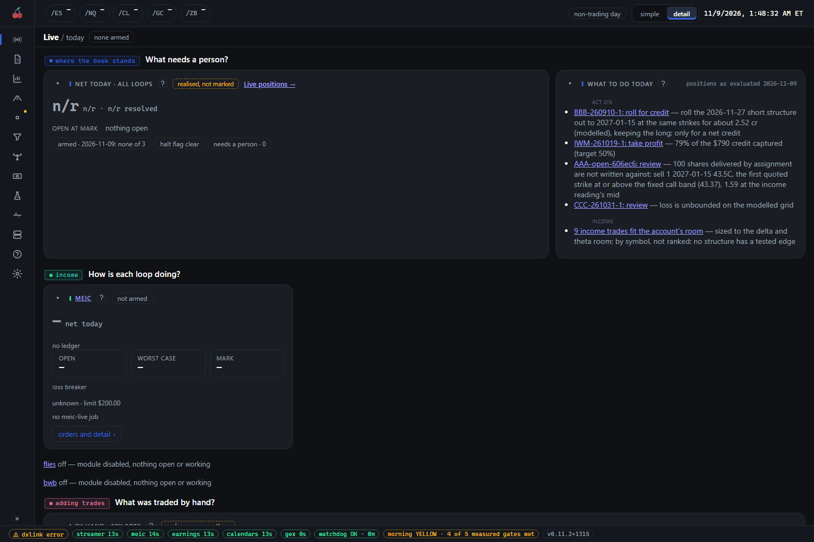

# The console at a glance

The console is the suite's one window: a page for each part of the suite, all inside the same frame.
This page explains that frame, which is the same on every page: the left rail, the top bar, the bottom
status bar, and the Help page at `/help`, with its FAQ at `/help/faq`. Opening the console's address
(port 5070 on your own machine) lands you on the Live page, `/live`.

## What you see

### The left rail

The rail lists every page, in this order: Live and the market reads (Reports, Charts, GEX, GEX panel,
Screeners), then a Modules section (MEIC, BWB, Earnings, Experiments), then Research (Compare,
Backtest, Advisor), then a Suite section (System, Help) with Config last. A page that is switched off
for your install drops off the list.

- **Collapsed by default.** It starts as a thin strip of icons. The `»` button at the foot opens it to
  show names, and `«` folds it back. A small amber dot on the Config icon means you have unsaved
  changes there.
- **The page you are on opens out into its tabs.** Its name becomes a heading, with its tabs listed
  beneath it. Clicking a tab keeps any date or arm choice you made.
- **Experiments** holds the paper-only experiments. While you are on one, it opens out under
  Experiments.
- **Hover a link** to see its shortcut. The keyboard shortcuts are:
  - `g` then a letter goes to a page: `g l` Live, `g r` Reports, `g c` Charts, `g g` GEX, `g i`
    Screeners, `g m` Compare, `g b` Backtest, `g a` Advisor, `g s` System, `g h` Help, `g o` Config.
    Press the second key within a second of the first.
  - A digit goes to a module: `1` MEIC, `2` BWB, `3` Earnings, `4` Experiments. A module that is off
    leaves its digit unused; the others keep theirs.
  - `j` and `k` step to the next and previous tab of the page you are on, and stop at the ends.
  - Nothing fires while you are typing in a box.

### The top bar

From left to right:

- **The futures ticker**: ES, NQ, CL, GC and ZB, each with a price and its change. A dash means no
  price has arrived yet. On a tablet the change shows as a percentage only. On a phone the ticker
  gets its own row, and prices of 1,000 or more are shown without cents.
- **The session chip**: `market open`, `trading day, closed` or `non-trading day`, from the watchdog.
  It does not appear until the watchdog has reported once. On a narrower screen it shortens to `open`,
  `closed` or `no session`, and the clock shows the time without the date.
- **The simple and detail switch.** See below.
- **The clock**, in Eastern time.

### The bottom status bar

Chips along the foot of every page say whether the suite is healthy. They only report; none of them
does anything to your account.

| Chip | What it says |
| --- | --- |
| `dxlink` | The console's own live-quote connection. `idle` is normal when no page is watching live quotes: the console then reads the shared stream cache. `error` is amber and worth a look. |
| `read-only credential` | Amber. The saved broker credential cannot place orders, so the broker dry-run check is off. Nothing else is affected. |
| One chip per producer | `streamer`, `meic`, `earnings`, `calendars`, `gex` and so on, each with the age of its last event, for example `streamer 13s`. Green is on time against that producer's own schedule; red with a warning mark is over its limit. Click one to open its page. |
| `module switches unknown` | Amber. The console could not read which modules are on, so it shows every page, including any that are off. |
| `watchdog OK` | The watchdog's verdict and how many minutes since it last ran. Anything other than OK is amber. |
| `morning GREEN`, `YELLOW` or `RED` | The morning report's phase, with how many of its measured gates were met. |
| The version | The release you are running. It turns amber and reads, for example, `v0.12.0 · v0.13.0 available` when GitHub has a newer release. Click it for the release notes; hover for how to update. An old version keeps working, so it is never red. |

## How to read it

### Simple and detail

The switch at the top right changes how much each page shows, and the choice is remembered. **Detail**
is the default and shows every tab, table, gate and study. **Simple** keeps each page's summary, its
main chart, performance and positions. In the rail, simple view also drops Compare, Backtest, Advisor
and System, which are for digging into the suite, and drops some tabs inside a page, such as the Live
page's `flies` tab. Inside a page, some columns and tiles appear only in detail view. The page or tab
you are standing on is always listed, so a link someone sent you still works.

### Tabs and addresses

Every tab has its own address: the page, a slash, then the tab. For example, the Live page's positions
tab is `/live/positions`. A tab stays open when you reload, and you can bookmark or share it. The page's
bare address opens its first tab.

### The experimental chip

A small `experimental` chip beside a page's name means it is a paper-only design still being shaped:
the paper pages under Experiments (such as Calendars and Contango) and the GEX panel carry it. It never
places an order, and its results are a reason to look, not a reason to trust.

## What to do

- **Glance at the status bar first.** Green chips with small ages mean everything is producing. A red
  chip with a warning mark means that producer has stopped; click it to see why.
- **Do nothing about `dxlink idle`**, or about an amber version chip. Update when it suits you, after
  reading the release notes.
- **Learn five shortcuts**: `g l`, `g r`, `g h`, `j` and `k`.
- **Find help in the console.** The Help page (`/help`) opens on the guides, with a search box, a list
  down the left and the page's headings on the right. The FAQ (`/help/faq`) holds the same questions as
  [faq.md](faq.md), each a row you can open, with a filter box and an expand-all button.

Next, the Live page: [live.md](live.md).
