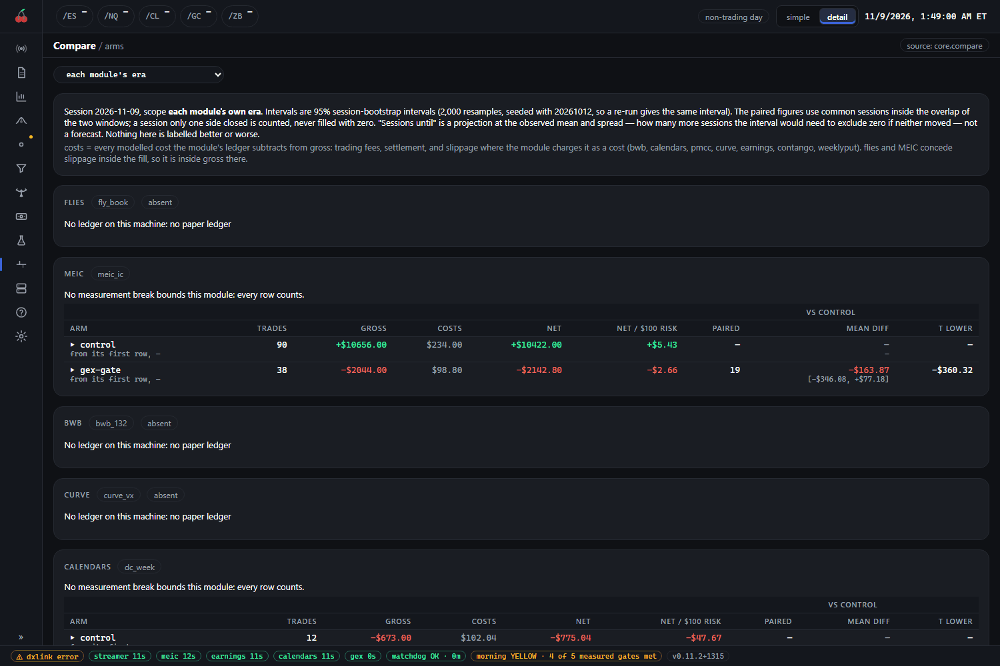

# Experimenting with arms

An arm is how the suite tests an idea. You do not change a strategy and hope. You add a variant beside
the plain version, let both trade the same market, and read the difference. This page covers adding or
changing an arm, when a change takes effect, how to read the result, and when to stop an arm.

Everything here is paper. An arm never trades real money by being good. Which arm a live loop trades is
a guarded setting you edit by hand, and the Config page refuses it.

## What an arm is

An **arm** is one configured variant of a module: the same strategy with a named set of settings, run as
its own portfolio. Every enabled arm sees the same market snapshots on every tick, and every trade is
tagged with the arm that opened it. That is what lets the console put arms side by side.

Almost every module has a `control` arm, the plain version. Each other arm changes one thing from it.
Without a control a good result proves nothing, because you cannot tell the idea from the market.

Old files and notes spell it three ways: `profiles` (MEIC), `books` (calendars, and the retired modules)
and `arms` (contango, weeklyput). They all mean arm, and all three spellings keep working in every config
file. This guide says arm.

Two kinds of arm are not yours. The advisor, when you switch it on, adds `advised:<experiment>` arms
beside the control (see [research.md](research.md)). A few modules build in a comparison arm of their own,
such as calendars' `path`, which the exit-rule replay depends on; leave those as their example sets them.

## Adding or changing an arm

Arms live in each module's own config file under `~/.cherrypick/config/`. On Windows that is
`C:\Users\<you>\.cherrypick\config\`. If the file does not exist yet, copy the module's
`config.example.json` there under the module's name. Each example documents its keys inline, in the
`_note` entries beside them.

| Module | File | Arms are under | Shipped arms |
| --- | --- | --- | --- |
| MEIC | `meic.risk.json` | `profiles` | `control` |
| Calendars | `calendars.json` | `books` | `control` on, `path` off |
| Contango | `contango.json` | `arms` | `control`, `flipexit` |
| Weeklyput | `weeklyput.json` | `arms` | `unhedged` |

MEIC keeps its arms in a second file, apart from its base settings. If it has no `meic.risk.json` it
reads the shipped `config.risk.example.json`, which holds `control` alone. Copy that file into
`~/.cherrypick/config/meic.risk.json` and add arms beside `control`.

### The rules for an arm block

- An arm has a name (its key), `"enabled": true`, and the settings it changes. A `_summary` line saying
  what it tests is good practice; keys that start with an underscore are comments.
- **Contango, weeklyput and calendars** merge an arm onto the file's `defaults`, so an arm lists only the
  setting it changes.
- **MEIC** merges an arm onto the base `meic.json`, not onto `control`. `control` is a long block that
  switches the study gates off. To make an arm that differs from `control` in one thing, copy the whole
  `control` block, rename it, and change that one setting.
- Change **one** setting. Two changes together tell you nothing about either.

### An example in contango

Contango holds a short-volatility fund while the VIX to VIX3M ratio is under a threshold. Its `control`
arm enters below 0.97. To ask whether waiting for a lower ratio helps, add one arm beside the two shipped
ones, inside `"arms"`:

```
"enter93": {
  "_summary": "Like control, but only goes into the fund below 0.93.",
  "enabled": true,
  "enter_below": 0.93
}
```

Only `enter_below` differs from `control`. Between 0.93 and 0.97 the arm keeps whatever it holds. A pair
where the exit is below the entry is refused at the first tick, so keep `exit_at_or_above` at or above
`enter_below`. A new arm opens its own paper account: changing `starting_capital` on an existing arm does
not re-capitalise it.

### An example in MEIC

In `meic.risk.json`, copy the `control` block inside `"profiles"` to a new name and change one key. For
instance, `min_credit_pct_of_width` is the smallest credit an entry may take as a share of the wing width
(0.15 in `control`). An arm called `credit-20` that is `control` with that key set to 0.20 asks whether
a pickier credit floor helps.

### Check that it took

A config read defaults silently. A misspelt key, or an arm under a key a module does not read, does not
raise an error: the arm simply does not exist, or runs on its defaults, and the numbers still look fine.
After an edit:

1. Open the module's page in the console and its `arms` tab. Your arm should be listed.
2. Open Config, then the `arms` tab (`/config/arms`). MEIC's arms appear there, one switch each.
3. After the first session, check `decisions` (or MEIC's `attempts`) for the arm. A new arm that never
   attempts anything has a setting stopping it. Fix it before you read any result.

## When an edit takes effect

Most paper modules (MEIC, earnings, contango, weeklyput) run as a fresh process every minute, so they
read their config on the next tick. That is the danger: an edit made at 11:00 changes the arm **in the
middle of a session**, and that day's rows mix two rules.

Calendars is different. Its paper job is one long-running process that reads its config once when it
starts. An edit does not reach it until you restart the job:

```
python packages/orchestrator/run.py restart calendars-paper
```

Use the job name as `/system` shows it. A trading job keeps its state in its ledger, so a restart costs a
tick, not a day. If you are not sure whether a setting is live yet, restart the job that uses it. Turning
a module on or off, and timing changes, land on the supervisor's next pass without a reinstall; see
[system-and-config.md](system-and-config.md).

## The one-variable rule

Every arm differs from the reference arm in exactly one setting, and every comparison is of an arm
against its reference.

- **One variable.** If an arm changes the entry delta and the stop rule together, a better result cannot
  be put down to either.
- **The reference arm.** Compare against `control`, which sees the same market on the same ticks. Do not
  compare an arm with last month's results, or with a different module.
- **Sampling.** MEIC's `control` is a sampling arm: study gates off, no per-side stop, and it enters
  whenever it can, hundreds of condors a session. Many questions are answered by splitting its rows, with
  no extra arm needed: an entry filter is a pure filter on what `control` already recorded. Add a new arm
  only for something a split cannot express, such as a pinned wing width. MEIC's
  [paper-experiments.md](../../packages/meic/docs/paper-experiments.md) has the design.
- **Sessions are the sample.** Trades inside one day share a market, so a thousand trades from three days
  are three observations. The console counts sessions, and a bootstrap interval is not shown below 14.
  Read at 14 sessions, decide at 20 or more.
- **Zero counts as zero.** A session where an arm's filter blocked every entry is evidence, not a
  missing row. Comparisons use per-session means so a quiet arm is not flattered.

## When a change is a measurement boundary

A change that alters what a session's numbers mean restarts the evidence clock. These are measurement
boundaries: tick cadence, entry pacing, gate semantics, how net is defined, and which arms exist. Land
them together at a clean boundary, such as the start of a week, and write down the date. Do not
make one in the middle of a session.

- **A new arm is scoped to itself.** In MEIC it starts its own clock at its first session, so no other
  arm's evidence moves. Add arms freely, at a session boundary.
- **Changing an existing arm's setting** gives it a new history. If you want to keep the old arm's record
  readable, leave it as it was and add the new setting as a new arm, then turn the old one off.
- **Fixing a number that was recorded wrong** is not a boundary and lands at once. A display change is
  not one either.
- Rows carry an era, and the console reads each module from its latest boundary by default. Do not pool
  across eras. The scope selector's "all rows (pooled across breaks)" is a stated widening, never a
  default.

## Reading an arm

### On Compare (`/compare`)

The `arms` tab is a block per module with a row per arm. Read the paired columns, which compare the arm
with `control` over the sessions both closed, before you read the arm's own net. Net is after fees,
settlement and slippage. The `risk` tab adds the slippage at which an arm's net would reach zero. The
columns and caveats are in [research.md](research.md).



Three habits keep the reading honest.

- **Prefer the paired difference to the arm's own net.** A rising market lifts every arm. What matters is
  the arm minus `control`.
- **An interval that spans zero says the data cannot tell the arm from nothing yet.** The "sessions
  until" column projects how many more sessions the interval would need to exclude zero. It is a
  projection, not a forecast.
- **A row marked thin is not evidence.** It is shown so you know it exists.

### On the module's arms tab

Each module's `arms` tab shows one card or row per arm beside its control: what it entered, what it cost
and how it stands. On MEIC it is a tile per arm, with a large tile drawing every arm's day together. MEIC's
`control` trades on another scale, so its tile is dashed and left out of the large drawing and its net.
Open a tile for that arm's attempts and trades. Use `attempts` to see which gate turned an arm's entries
away. The tabs are in [strategy-pages.md](strategy-pages.md).

Paper is an upper bound on what a live account would see. An arm that only just beats `control` on paper
has not shown it would beat it with real fills.

## The Config page's editor

Config (`/config`) is the one place the console changes settings. Its `arms` tab is a switch per arm, to
turn an arm on or off. Adding an arm or changing a setting inside one means editing the module's config
file, as above. The page has guard rails you can rely on.

- **Nothing saves as you type.** Edits are staged, a bar counts them, and Save writes them as one change.
- **Every save goes through the orchestrator's config editor.** It backs the file up first and tells you
  where the backup is.
- **A conflict is caught.** If the file changed on disk after the page loaded, it reloads and asks you to
  check your edits and save again.
- **Live-trading fields are refused**, in either direction. That includes which arm trades live, the live
  caps and the live gate. The editor can neither arm nor disarm live trading.
- **A file it cannot read is not editable**, rather than guessed at.
- **It edits in place.** Your notes, key order and comments are kept.

Do not hand-edit a config file while the console has it open. The backup and the conflict check exist for
that case.

## The kill criteria

Decide before you start what would make you stop. A written stop is the only one that counts.

- **Name the verdict first.** Write down the measure, the sessions you will wait for, and the result that
  ends the arm, before you look at the data. An idea judged after the fact fits whatever happened.
- **Do not stop on a thin row.** A handful of sessions is not a verdict, in either direction. An arm that is
  ahead after five sessions has not won.
- **An arm that enters nothing is a finding.** One that enters zero trades for five sessions running is
  escalated, not quietly dropped. Find out which setting is stopping it.
- **Retire, do not delete.** To stop an arm, set `"enabled": false` and add a `_disabled_note` with the
  verdict and the date. Keep the block. A defined arm that is forgotten is worse than a documented one that
  is off, and a retired arm's record stays readable. In calendars, a built-in arm you delete from the file
  runs by default, so switch it off rather than remove it.
- **Live arms have a frozen stop of their own.** A live loop carries written kill criteria, set before it
  trades and never re-derived while it does. Crossing them first cuts the size of its entries, then blocks
  them, and a block stays until a person clears it. It closes nothing. That is separate from a paper arm's
  verdict, and it is edited by hand, not from Config.

## What to do

- Change one thing, in a new arm, beside the reference.
- Add it at a session boundary, then check on the `arms` tab that it exists.
- Write down the date, the one change and the verdict you are waiting for.
- Wait for sessions, not trades. Read the paired difference on Compare.
- Stop it by a written verdict, with `enabled: false`.
- When in doubt about a setting, run it as an arm, not as a change to `control`.
