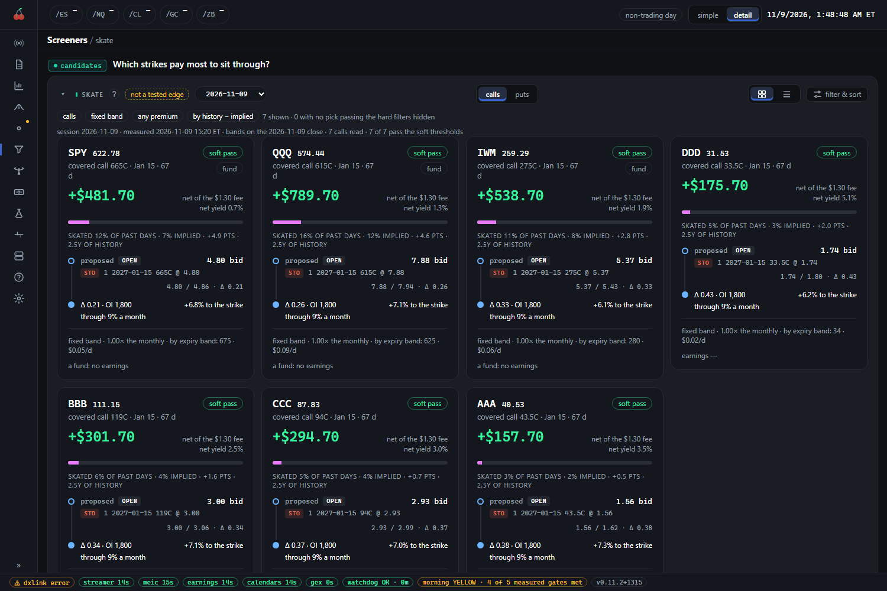
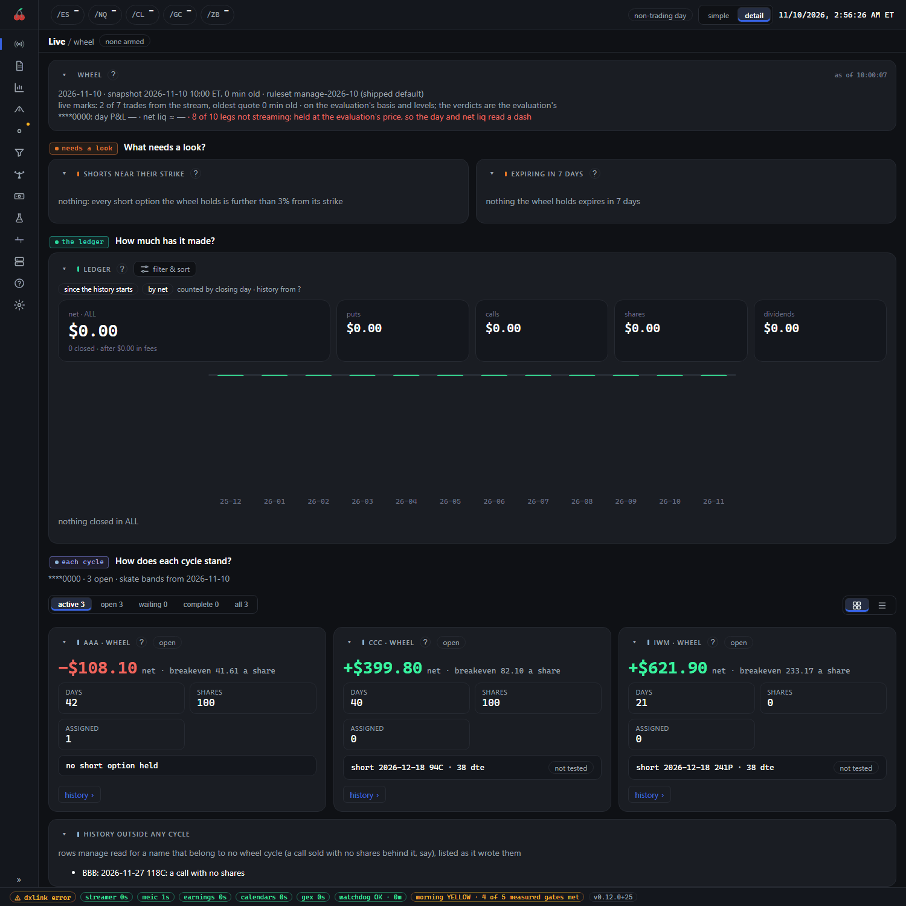

# Income trades, start to finish

This page follows one made-up stock, AAA, from a screen to a finished trade: a put sold, shares assigned,
covered calls written, and the same idea with a long call in place of the shares. The figures are
invented. They match the demo, so a demo install shows you the same cards.

**The suite never places these trades.** It finds candidates, reads your broker account and tells you what
its rules suggest. You place every order yourself, and the console is read-only. Nothing here is a tested
edge: the screens say so on every card. They are ways to find things to look at.

## The path in one picture

1. **Skate screen:** find a strike to sell outside the stock's recent range.
2. **Sell the put:** you place it, with cash set aside.
3. **The wheel view:** follows the put, and any shares it delivers.
4. **Assignment:** the put finishes in the money and you own 100 shares.
5. **Covered calls:** you sell calls against the shares until they are called away.
6. **The PMCC step:** a way to run step 5 with a long call instead of the shares.
7. **How the money reads:** the cycle's result, net, with every cost shown.

## Three things called PMCC

A poor man's covered call (PMCC) is a call sold against a long call instead of against shares. Three
different things in the suite carry the name, and mixing them up is easy.

| What | Where | What it is |
| --- | --- | --- |
| The retired paper module | `packages/pmcc`, the `/pmcc` page, `/experiments` | A paper experiment that traded PMCCs on its own, with no real money. It is retired and ships switched off. Its results are an estimate and it has nothing to do with your account. |
| **Live, then `pmcc`** | `/live/pmcc` | A view of the PMCCs in **your real account**, one card each. It reads your broker history. It runs whether or not the paper module is on. |
| The PMCC step in this flow | Step 6 below | A way of selling covered calls with a long call you bought yourself, instead of shares. |

If you want to know how your own PMCCs stand, you want the second. The first is history. The third is an
idea; once you have opened one, the second tracks it.

## Step 1: the skate screen

The skate screen is `/screeners/skate`. It lists covered calls sold above a name's recent range, and
cash-secured puts sold below it, for a seller who does not want assignment. Its tabs are `calls` and `puts`.
"Skate" means collect the premium and stay clear of the strike.

For each name the screen builds a band from the stock's recent high-to-low range over the sessions to
expiry. The call goes above the band and the put below it. Then it asks two questions of each strike:

- **How often did a strike this far out stay clear?** The screen counts the share of past days when the
  same band held to the close at expiry, over 11 years and over the last 3.
- **What does the market imply?** The option's own price implies a chance of finishing in the money.

A card shows the history and the implied figure side by side, with the gap in points. The gap is the point
of the screen. A strike where history beat the implied chance is where selling looks best.

In the demo, AAA is at 40.53 and its call card reads `covered call 43.5C`, expiring Jan 15, 67 days out,
with bid and ask 1.56 and 1.62. The big figure is the premium after the fee, at the working price. The
`soft pass` tag means the strike clears the soft thresholds (history at least 84%, last three years at
least 80%, skate yield at least 6%).

What to check on a card before you do anything with it:

- **The flag.** "not a tested edge" is on every skate card. The best expiry the screen picks is not a tested
  edge either.
- **Earnings.** The screen drops an expiry that spans a company's report, and drops a stock whose report date
  is unknown, because unknown is never clear. Funds are exempt.
- **Dividends.** A call is at risk of early assignment ahead of an ex-dividend date when it is in the money
  with little time value (see "The limits").
- **Liquidity.** Open interest and the spread bars are hard filters, so a name that fails is hidden.
- **The `leveraged` chip.** A daily-reset fund decays and gaps in ways its delta does not price.
- **The date and quote time** under the title. The quotes are taken at 12:00 and 15:05 ET.

## Step 2: selling the put

Say AAA traded near its band's lower edge and you chose a put at the 42.50 strike, 28 days out, for
**0.95 a share**. That is $95 for one contract, and the order chain reads `STO 1 ... 42.5P @ 0.95`. You
send it from your broker.

A put like this is **cash-secured**: you keep the money to buy the shares if they are put to you, 42.50
times 100, or $4,250. In a margin account the requirement is smaller, but the shares are still yours to buy
if assigned.

Three outcomes follow:

- **It expires worthless** (AAA stays above 42.50). You keep the $95 and the trade is done.
- **You buy it back early.** The wheel rules suggest this once the short is at 0.03 (0.05
  if the market is wide), buying back the put alone.
- **It finishes in the money and you are assigned.** Go to step 4.

Check the buying power before you send it. The Screeners list shows a `fits` or `does not fit` chip against
your account; see "The limits".

## Step 3: the wheel view

From the day you sell the put, the Live wheel tab (`/live/wheel`) follows it. The wheel view reads your
broker's order history and links the orders into one cycle: the put, the shares if it delivers any, and the
calls written against them, until the shares are called away or sold. Each cycle is a card.

The tab answers four questions. **What needs a look?** lists shorts within 3% of their strike, and anything
expiring in 7 days. **How much has it made?** is a ledger of puts, calls, shares and dividends. **How does
each cycle stand?** is a card per name with its net, breakeven, days, shares and the short it holds. **What
would a trade do?** is a payoff for a trade you are thinking of.

A cycle that cannot be rebuilt from your history is `unreconciled`. Its figures are shown as far as the
rows go, but no rule judges it, only a note saying why. Do not trust it until that is fixed.

## Step 4: assignment

In the demo, the put above was sold 42 days ago for 0.95 and finished in the money. You were assigned
100 shares of AAA at 42.50. Nothing needed doing. The wheel card for AAA now reads:

- `ASSIGNED 1` and `SHARES 100`;
- **breakeven 41.61 a share,** which is below the 42.50 you paid;
- a net of **-$108.10**, in red;
- `no short option held`.

That is a real position, and the card is honest that it is under water, because AAA has fallen to 40.53.

**Two costs for the same shares.** The *tax basis* is 42.50, the price the shares were acquired at. The
*wheel basis* is what the shares have cost once every premium,
fee and roll in the cycle is counted. Here the 0.95 premium and the fees bring it to 41.61. The wheel basis
is what you must sell above to come out even.

The net reads -$108.10 because the shares are worth $197 less than you paid (42.50 less 40.53, times 100),
the put's premium gives back $95, and fees take about $6, the assignment fee among them.

With shares held and no call written, the wheel's `wheel.next_leg` rule is waiting. It is a review, not an
order.

## Step 5: covered calls

The rule suggests the next leg: a call against the shares, at a strike moved to today's price, on the
quoted monthly, the first strike at or above the price. It flags a strike that is under the wheel basis,
since a call assigned there would lock in a loss. It follows the skate screen's call band, and in the
demo that is the card you have already seen: AAA's `43.5C`, 67 days out.

Selling it at the working price of 1.59 a share is $159 before fees. The strike is above the wheel basis
(43.50 against 41.61), so being called away would be a gain. The wheel basis drops by the premium, to about
40.0. You send the order.

After that the cycle follows the call.

- **It expires worthless.** You keep the shares and the premium. Sell another call.
- **It is tested** (AAA at or through 43.50). The wheel rules suggest rolling out in time, or closing. A
  roll is only suggested for a net credit, and it never moves the strike toward the money.
- **It is bought back at 0.03 or less.** The rule `wheel.take_profit` suggests that: nothing is left to
  earn.
- **The shares are called away at 43.50.** The cycle is complete.

If AAA keeps falling, the call does not help. The call's premium is small against a falling stock. You
are holding shares, with all that means.

## Step 6: the PMCC step

Owning 100 AAA shares ties up about $4,050 at 40.53. A **PMCC** gets a covered call's exposure for less
capital, by holding a deep in-the-money long call in the shares' place.

The idea, with invented figures: instead of the shares, buy a long AAA call at a 30 strike, about a year
out, for 12.60 a share ($1,260). It is deep in the money, so it moves close to the stock, one for one. Then
sell the 43.50 call against it for 1.59, as in step 5.

The suite recognises a PMCC by its shape: one long call and one short call of the same size, the short
expiring first at or above the long's strike, and no shares. The long also has to have been bought at a
delta of 0.70 or more. A trade that has the shape but not that delta is a diagonal, and keeps the diagonal
rules. If you want to override a decision, there is an `intent` setting on the trade or the name.

The check that matters is the **width check.** If the short is assigned, you are worth the strikes'
width and no more. So the short strike less the long strike (13.50) has to be more than what the long has
cost you after every premium collected (12.60 less 1.59 is 11.01). It passes. If it were assigned, the
trade would be worth $249 before fees, the width less the net cost. A PMCC that fails this check loses money
if assigned.

This is what Live, then `pmcc` shows for your real PMCCs, one card each. It has the long's delta and days
left, the short's state, the width check and the money. The rules suggest rolling the short at 21 days or
when 80% captured, and flag the long at 120 days left or under 0.70 delta. Early exercise is the thing to watch:
a short call in the money with less time value than the next dividend can be exercised before the ex-date,
and that leaves you short the shares until you exercise or sell the long. The page flags that for review.

A PMCC is leverage. A long call can lose all its value, and the long is the capital you paid. The
suite's own PMCC study found that the short calls' edge rests on a volatility
assumption, and that the held long call did most of the work. Treat the short calls as routine income on a
position whose direction you already want.

## How the money reads

Every figure follows the suite's one layout. The full rules are in
[money-layout.md](../conventions/money-layout.md). On this page:

- **P&L means net.** Gross less fees and settlement. A gross figure says so.
- **Signed cash.** A credit is `+` and a debit is `-`. Selling the put is `+$95.00`. Being assigned is
  `-$4,250.00`. Selling the call is `+$159.00`. Being called away is `+$4,350.00`.
- **Whole-position dollars,** for the full contract, apart from a net price, which is per share and marked
  `cr` or `db`: `0.95 cr`.
- **Fees and settlement are their own columns.** The assignment fee is shown apart, never folded into a
  price.
- **A missing cost reads `n/r`,** never zero, and a total that depends on it reads `n/r` too.

Put together for AAA, if the call is sold at 1.59 and the shares are called away at 43.50:

| Step | Cash |
| --- | --- |
| Sell the 42.50 put at 0.95 | +$95 |
| Assigned: buy 100 shares at 42.50 | -$4,250 |
| Sell the 43.50 call at 1.59 | +$159 |
| Called away: sell 100 shares at 43.50 | +$4,350 |
| Gross over the cycle | +$354 |

Fees come off that, each in its own column. $354 on the $4,250 set aside is 8.3%, over about 16 weeks.

The wheel ledger counts each leg's net after fees on its closing day: the puts, the calls, the shares and
the dividends. A cycle is **complete** when it is flat and its credits exceed its debits; one that ends
flat at a loss is not complete. The `skate yield` on a card is premium over capital, scaled to a year, to
compare trades with each other. It is not a forecast.

## The limits

- **Advice only.** The suite places no order for these trades and cannot. The evaluation reads your
  account and posts what its rules suggest, such as `take profit`, `roll for credit`, `close` or
  `review`. The explanation and the rule behind it are on the card. Those rules are the ruleset's
  defaults, which you can see and change under Config, then `rules` (`/config/rules`).
- **It is switched on separately.** The daily position evaluation behind the Live tabs is off until you
  turn on *Daily position evaluation* under Config, then `rules`.
- **Earnings.** The screens drop expiries that span a report, and a name with an unknown date. A put is
  never rolled through earnings. An `earnings in the trade` chip on a list card warns of a report before
  expiry.
- **Ex-dividend.** A short call in the money, with less time value than the dividend, ahead of an ex-date,
  is flagged for review (`ex_dividend`). In a PMCC the same exposure has its own rule (`pmcc.assignment`).
  Early assignment is real, though often it does not happen.
- **Buying-power bands.** A list trade is judged against your account. A short put may not exceed 25% of
  net liquidation value in notional in a cash account or IRA (50% on margin), and one trade's risk is
  capped at 3% of net liq. On margin, total buying power used is held to a cap that rises with the VIX:
  25% under 15, 30% under 20, 35% under 30, 40% under 40, 50% above. A cash account or IRA holds each
  short put's full strike and each spread's max loss, and neither grows when the market moves, so it is
  held to 80% in total instead, with short puts (at their strikes) plus shares under 65% of net liq and
  spreads' max loss under 35%. A fall of 20% with volatility up is flagged when it would cost over 20% of
  net liq. A trade that does not fit shows the cap that stops
  it, and one stopped only by how full the book is waits in a queue, sized as if there were room. Treat
  these as the suite's defaults, not rules about your account.
- **Prices are modelled.** Credits are at a working price from an afternoon reading, and a mark is a mid,
  not a fill. Re-quote before you send.
- **Paper is not this.** Nothing on the screeners or the Live account tabs has a paper ledger behind it.

## What to do

- Use the skate screen to find a short list, then read the name's chart and its earnings date yourself.
- Check `fits` before you size anything. Size by what you can afford to own at the strike.
- After a put is assigned, read the wheel card: the basis, the net and the rule's next leg. Choose your own
  call; the suggested strike is a place to start.
- Read `needs a look` on the wheel tab each morning, especially any short near its strike.
- If a cycle says `unreconciled`, fix the cause or ignore its numbers.
- Do not read an income screen as an edge. A frequent win is not a profit. A put that is assigned in a
  falling market loses more than the premium collected.

See [screeners.md](screeners.md) for the other income lists and [live.md](live.md) for the account tabs.
