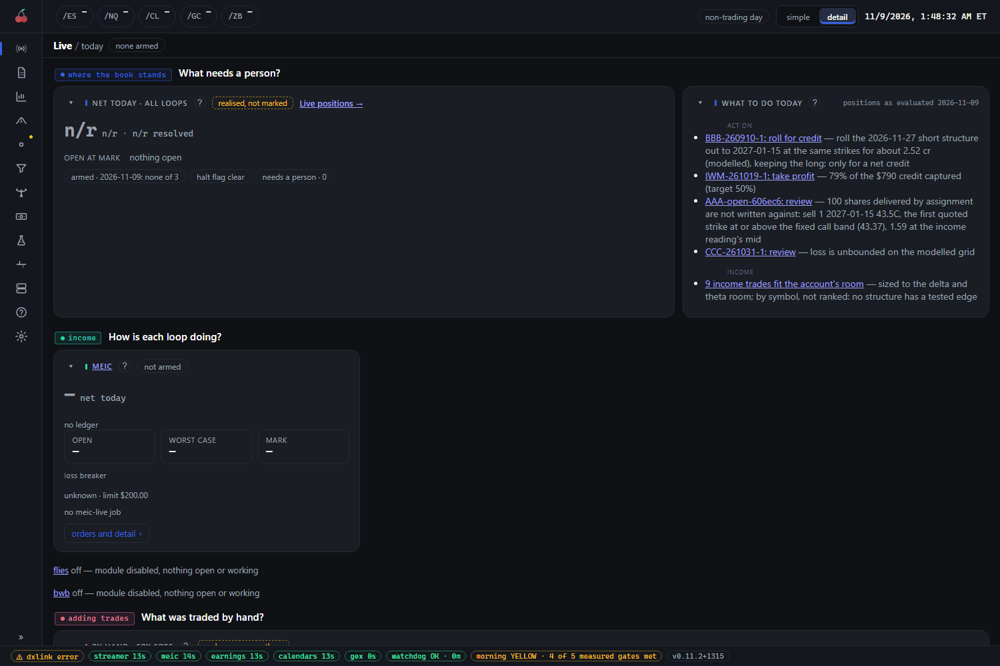
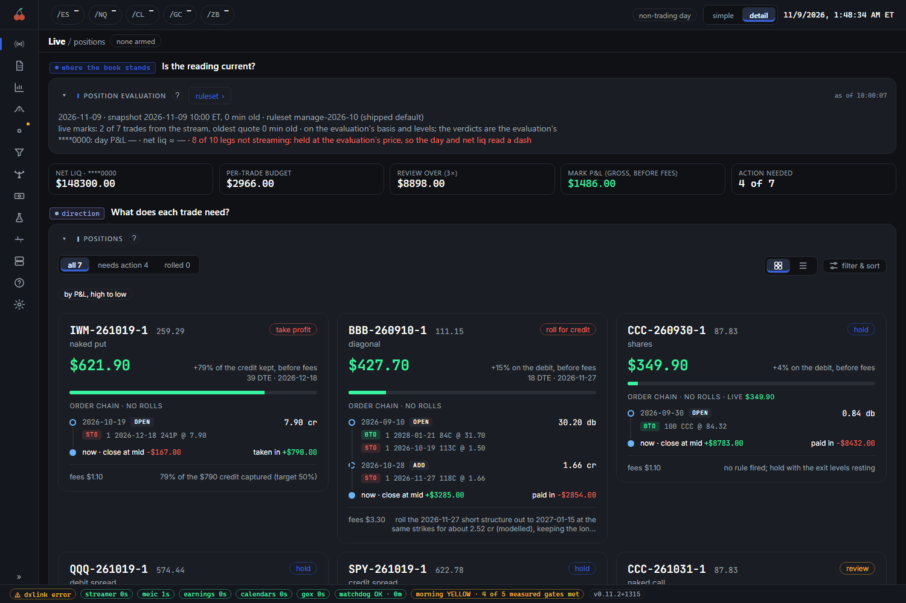
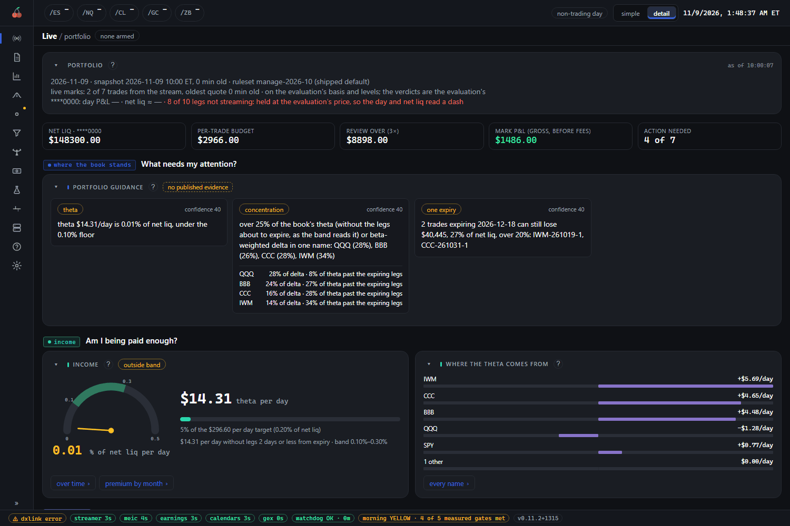
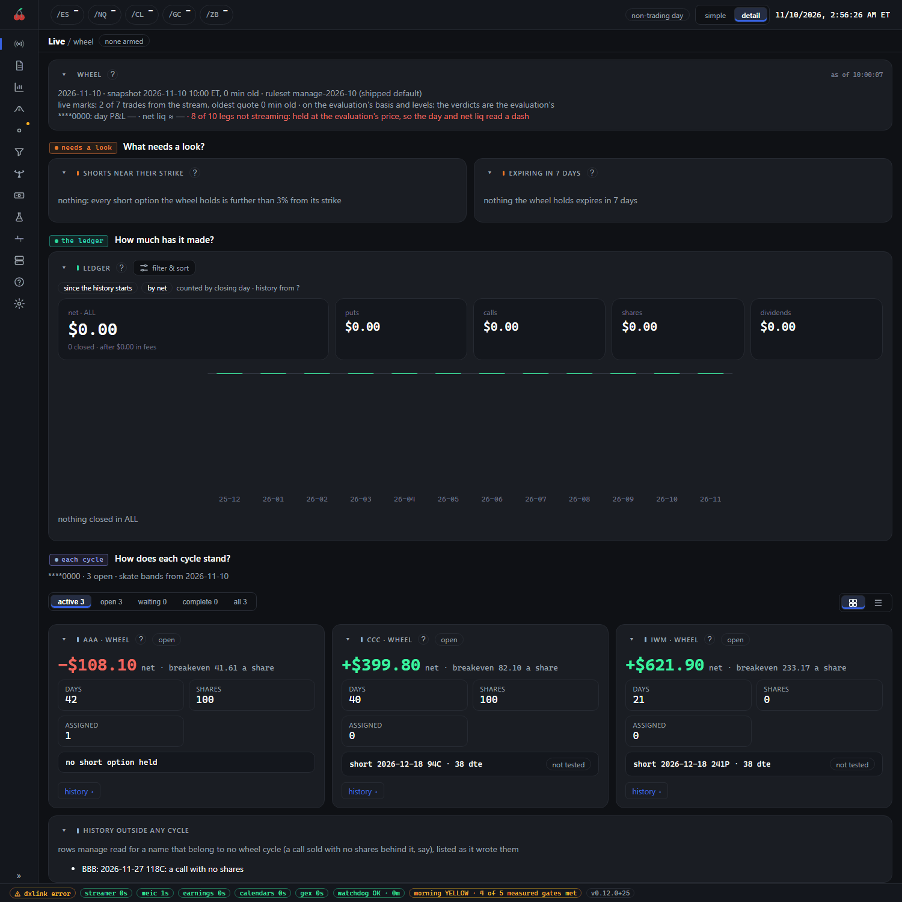

# Live

The Live page is where real money is shown, and it is read-only: nothing on it can place, change or
cancel an order. It has seven tabs: `/live/today`, `/live/positions`, `/live/portfolio`, `/live/wheel`,
`/live/pmcc`, `/live/flies` and `/live/meic`. Opening the console lands you on `/live`, which shows
the first tab. Older bookmarks still work: `/live/manage` goes to positions and `/live/execution` goes
to meic.

## What you see

### Two kinds of tab

The tabs answer two different questions, and the difference matters.

- **Your real account.** `positions`, `portfolio`, `wheel` and `pmcc` are four views of one thing: the
  daily evaluation of every trade in your broker account, written by the manage package on trading
  days. It is off until you switch on "Daily position evaluation" on Config's `rules` tab. It runs at
  `manage.at` (10:00 ET) and at any further times in `manage.also_at`, and again when the account
  changes. The console only reads that file. The verdicts, the
  levels and the prices are the evaluation's; the page shows them. `today` also reads it, for its
  "what to do today" list.
- **The suite's own live loops.** `meic` (and the retired `flies`) show one module's live loop: whether
  it is armed for today, what it has open and what it has settled. These are trades the suite placed
  itself, on a day you armed it. `today` adds up all the loops on one page.

The `pmcc` tab here is not the paper PMCC experiment: it reads the PMCCs in your real account.
Nothing on the other pages is real money unless a module is live and armed.

### The header

Under the page name, a chip sums up trading status. On the account tabs and `today` it reads
`none armed` or, say, `1 armed`, with `HALTED` added when the halt flag is up, and `needs a person`
when something wants you. On `meic` it is that module's own arm record: `meic · not armed · SPX`.
On `flies` it is the pilot's. Hover for the detail. Each live loop is armed separately, which is why
one chip does not cover both. On the right sits the alert-daemon chip.

### today

Three questions, in order. **What needs a person?** is the net for today over all loops, with what is
still open at mark beneath it, chips for what is armed and whether the halt flag is clear, and the
"what to do today" list drawn from the evaluation. **How is each loop doing?** is a card per loop: its
net today, open count, worst case, mark, and a loss-breaker meter, with a button to its orders and
every detail. A loop that is switched off is listed in one line. **What was traded by hand?** shows
your own 0DTE trades, stated beside the total and never in it. In the demo above, nothing is armed,
the net reads `n/r` and the MEIC card says `no ledger`, because no live session has been recorded.

### positions

The header says which evaluation you are reading: the session, the snapshot time and how old it is,
and the ruleset. Below it, tiles show net liquidating value (the account number is masked), the
per-trade budget, the size at which a trade is flagged for review, mark P&L and how many trades need
action. The per-trade budget and review tiles show in detail view only.

Then a card per trade, such as `IWM-261019-1`: its action chip (`take profit`, `roll for credit`,
`hold`, `review`), its net P&L, how much of the credit is captured, days to the nearest short leg, and
the order chain that built it, each order with its legs and signed cash. Open a card for the exit
levels, the closing order a person would enter, the rules that fired and the legs. Filters are
`all`, `needs action` and `rolled`; sorts include P&L, days to the nearest short and needs action
first. A `ruleset` button opens the settings the evaluation used.

### portfolio

The same evaluation read as one book, in six questions: what needs my attention (portfolio guidance
and the account tiles), am I being paid enough (the income dial and where the theta comes from), which
way am I leaning (the direction dial and where the delta comes from), what happens if it moves (a
stress table and graph), do I have room to act (buying power against a limit that rises with VIX), and
what could I add. A card compares the suite's greeks with the broker's own.

### wheel

Each wheel cycle on the account (puts sold, shares assigned, calls sold against them). The questions
are what needs a look (shorts near their strike, and anything expiring within 7 days), how much the
wheel has made (a ledger of puts, calls, shares and dividends), how each cycle stands (a card per name
with its net, breakeven, days, shares and the short it holds now) and what a trade would do. In the
demo the ledger reads `$0.00` because no cycle has closed; the three cards below show the open ones.

### pmcc

Each poor man's covered call on the account: which needs action, then a card per position with the
long leg's state, a width check, the money and the rules that fired.

### meic and flies

`meic` answers can it trade today (arm, disarm time, halt flag, live gate and symbol, orphaned orders,
held orders), what is open (open iron condors) and how it has done. `flies` is the same for the flies
pilot, which is retired; its tab keeps the history and shows `module off`. Either tab disappears from
the rail once its module's live switch is off and nothing is open, working or owed settlement.

## How to read it

- **Real versus paper.** Live shows your account and live loops. A paper module's results are on its
  own page and are an estimate: paper is an upper bound, because fills in real life are often a
  little worse. See [strategy-pages.md](strategy-pages.md).
- **Money follows one layout** ([money-layout](../conventions/money-layout.md)). P&L means net:
  gross less fees less settlement. A credit received is `+` and a debit paid is `-`. Figures are whole
  dollars for the whole position, except a net price, which is per share and marked `cr` or `db`.
  Fees and settlement are separate columns. Where a cost was never recorded the cell reads `n/r`,
  never zero, and the total reads `n/r` rather than a number that looks complete. Where a figure is
  gross it says so: the `mark P&L (gross, before fees)` tile is gross, and each card's P&L is net.
- **A mark is a mid, not a fill.** Open positions are valued at the middle of bid and ask. A closing
  order listed on a card is what you would enter, not what will fill.
- **After a trade the page updates by itself.** Prices move every minute. A fill starts a new
  evaluation about a minute after the last leg (several legs or orders close together are one run), and
  the account's held positions are checked every five minutes, so an assignment, an exercise or a
  transfer shows up too. No run starts within two minutes of the last one. The Discord post follows the
  list: it goes out when the trades needing action change (and on the day's first run), not on every
  run, and the post says what started the run. `manage.on_change` in the config turns this off or tunes
  it.
- **Check the age.** The evaluation runs at its scheduled times and whenever the account changes. If the newest is much older than the last scheduled time, the header
  turns red and says a run looks to have been missed. A snapshot taken before 9:30 uses the last
  close. A dash instead of a live mark means a leg has no fresh quote.
- **Net today is realised.** It counts only positions resolved today. The worst case is each loop's
  own measure and is never added up across loops.
- **The loss breaker** compares the day's loss to a limit; a tripped breaker stops new entries. `no
  limit` means none is configured, which is not the same as clear. MEIC's figure is gross.
- **The halt flag** is suite-wide. When it is up the header says `HALTED`, in red. It blocks new
  entries on every loop; open positions are still managed and closed. Clearing it arms nothing.
- **The alert-daemon chip** is the flies order-alert daemon's health: `alert daemon ok`, `stale`,
  `down` or `off`. Amber means fills are noticed later, by the loop's own poll, not that anything is
  lost. `off` is normal when nothing is armed, and with flies retired it is the usual state.

## What to do

- **Most days, nothing.** If `today` says `none armed` and nothing needs a person, you are done.
- **When a trade is marked `take profit`, `roll for credit` or `review`,** open its card, read the
  explanation and the rule that fired, and decide. The suite will not do it for you.
- **If the snapshot is old,** check the status bar's watchdog and manage chips before trusting any
  verdict.
- **To stop new live entries,** use the Halt button on the Config page (see
  [faq.md](faq.md#how-do-i-stop-everything-right-now)). The Live header will show `HALTED`.
- **Before arming a loop,** read *Going live safely*. Reading these tabs never arms anything.

For the frame around this page, see [console-tour.md](console-tour.md).
