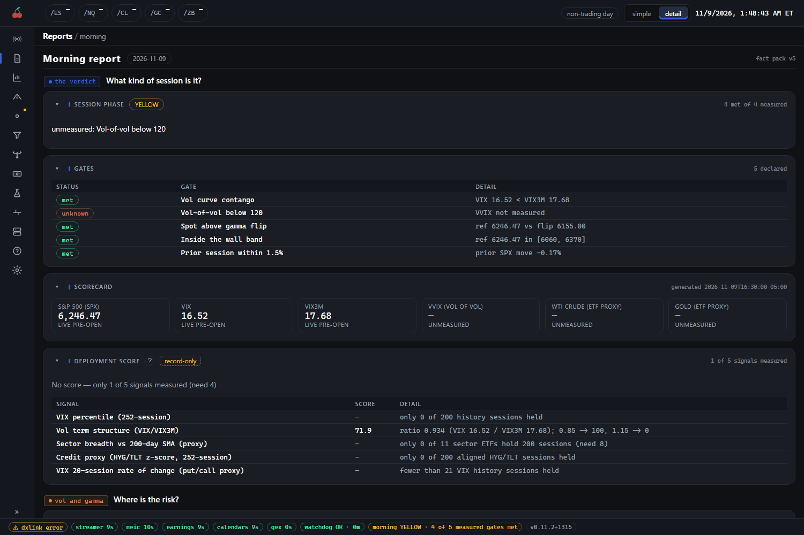
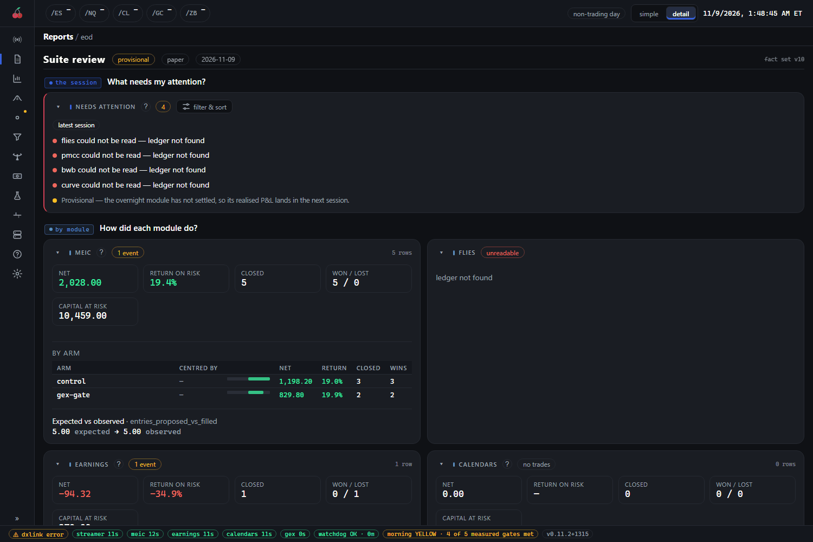

# Reports

Reports holds the suite's written-up sessions: the pack made before the open, the review made after the
close, and any report your own scripts write. The page is `/reports`, with three tabs: `/reports/morning`,
`/reports/eod` and `/reports/external` (one report of the external tab is `/reports/external/<id>`). The old
addresses `/morning` and `/review` still work and land on the first two.

Every figure on the first two tabs is read from a file another package wrote (the overview package writes
the morning pack, the review package the end-of-day review). The console computes nothing, so the page,
the written note and any Discord post cannot disagree about a session.

## What you see

### The morning tab

The page is titled **Morning report** and carries the session date and the fact-pack version. It is a
set of cards under questions, in this order.

- **What kind of session is it?** The **Session phase** card shows one chip, GREEN, YELLOW or RED, with the
  reason in a sentence and "4 met of 4 measured" beside it. Under it, the **Gates** card lists the five
  tests the phase is made from, each with a status (`met`, `not met` or `unknown`) and the measured value.
  The **Scorecard** shows the headline readings (S&P 500, VIX, VIX3M, VVIX, crude and gold; crude and gold
  are ETF proxies and say so). The **Deployment score** card is a recorded measurement only.
- **Where is the risk?** **Gamma levels**: the put wall, the gamma flip and the call wall against the
  reference price, then **Vol term structure** (record-only).
- **What is moving before the open?** **Pre-market**, the **Sector board** (strongest and weakest chips)
  and **Expected move and yields**. When the suite's technicals feature is on, the technicals cards follow:
  Breadth, Stages by sector, Rotation, Relative-strength leaders, Session movers and Scan signals.
- **Where is the options activity?** **Hot options** (record-only): the day's heaviest option volume by
  contracts, against recent sessions.
- **What is on the calendar?** **Calendar**: scheduled releases and earnings for the next seven days.
- **What does the note say?** **Narrative**, a written reading of the pack, when one exists.

If more than one pack has been written, the Scorecard's filter and sort button lets you pick an earlier
session. With no pack yet the page says "No morning pack has been written yet. The report runs before the
open."

### The eod tab

The page is titled **Suite review**. Chips beside the title say whether the review is `provisional` or
`final`, that it covers `paper` trading, and the session date.

- **Needs attention** is first. It is a short list of things that went wrong: a module that could not be
  read, a loop that did not tick at all ("a stopped loop, not a quiet day"), iteration errors, a jump in
  trade count that looks like a regime change nobody journaled. A green `clear` chip with "Every module
  ticked, none errored, and no unjournaled regime change" is a good answer. (On the demo, the retired
  modules have no ledger, so they are listed as could not be read.)
- **By module** has one card each. Its tiles are Net, Return on risk, Closed, Won / lost and Capital at
  risk. A module with several arms gets a **By arm** table with a bar on each arm's net. **Expected vs
  observed** compares what a model expected with what happened, when a model was recorded. A module that
  could not be read shows an `unreadable` chip and the reason.
- **Note** is the written reading, when there is one.
- At the foot, **This era** (or **All time**) adds up each module's net over every built session, with a
  small line for the running total. A module with one session gets no line.

### The external tab

The `/reports/external` tab shows whatever reports your own scripts have written. The suite ships none. It
has an overview of every report file, then one tab each at `/reports/external/<id>`. It is covered in full
in [external-reports.md](external-reports.md), including the file format and how to post a report to
Discord.

## How to read it

**The phase is mechanical.** GREEN, YELLOW and RED come from five declared gates, not from anyone's
opinion. The gates are: the vol curve in contango (VIX under VIX3M), vol-of-vol below 120 (VVIX), spot above
our gamma flip, spot inside the put-wall to call-wall band, and the prior session's SPX move inside 1.5%.
The rules, written in the code:

- RED needs a measured stress failure: the vol curve inverted, or VVIX at or over its line.
- GREEN needs everything measured to be met, at least four of the five measured, and the vol curve, VVIX
  and spot-versus-flip all measured.
- Anything else is YELLOW, and the reason names the gate that blocked it.
- Missing data never makes RED and always blocks GREEN. An `unknown` gate is not a pass.

The demo above shows this: four gates are met, yet the phase is YELLOW, because VVIX was not measured. The
thresholds live in the code, not in config, so a phase history stays comparable over time.

**Null is not zero.** A dash or `UNMEASURED` means nobody measured it. A reading with a muted look, or a
label such as `prior`, is the last completed session's value standing in for a live one. Before the open,
the gamma levels are normally the prior session's.

**Record-only cards decide nothing.** Deployment score, Vol term structure and Hot options carry a
`record-only` chip. They feed no gate, no phase and no sizing. The deployment zone is a neutral chip on
purpose, and it may disagree with the phase.

**The review is paper and may be provisional.** `provisional` means an overnight module has not settled, so
its realised P&L lands in the next session. P&L here is net. Return is on maximum risk, and an arm's bar is
scaled to the largest absolute net in its module, so a loss and a win of the same size look the same
weight. There is deliberately no suite total: the modules differ in size by more than an order of
magnitude and a sum would describe only the largest. A module whose trades were all one market event shows
an `event` chip: they are not independent observations.

**Arms that share a rule are one observation.** If every arm of a module was centred the same way that
session, the card says so. A GEX-centred arm with no open interest cached degrades to the at-the-money
arm, which makes it the control under another name.

**Notes are interpretation.** The Narrative and Note cards are written from the numbers above them. The
numbers are the record, the prose is a reading.

## What to do

- Read the morning phase as a summary of the market's conditions, not an order to act. Open the Gates card
  and check which gate is `not met` or `unknown`.
- If a gate is `unknown` on every pack, a feed behind it is probably down. See [faq.md](faq.md).
- On the eod tab, start with Needs attention. Do nothing about a `clear` list. If a module "did not tick",
  its loop stopped: look at it on the pages described in [system-and-config.md](system-and-config.md).
- Do not judge an arm on one session. Use the era card for the trend and the Compare page for the rest.
- An external report that shows `stale` or `invalid` is your script's to fix, not the console's.
