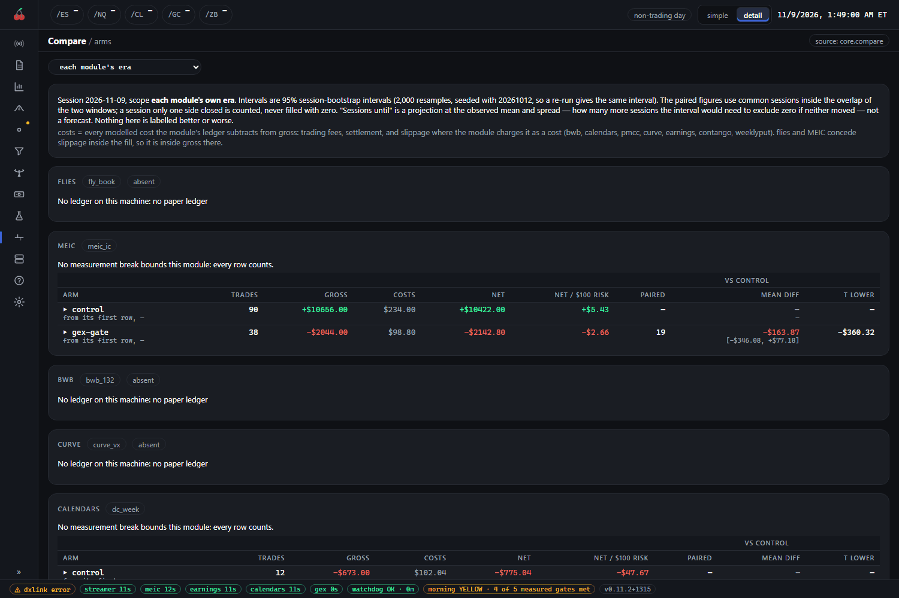

# Research pages

Three pages look across the suite rather than at one module: Compare at `/compare`, Backtest at `/backtest` and the Advisor at `/advisor`. Compare is always there. Backtest and the Advisor are off by default and do not appear until you switch them on.

## Compare (`/compare`)

Compare puts every arm of every module beside its own control, from one reader, so the numbers are measured the same way everywhere. Its tabs are `arms`, `risk`, `calendar` and `portfolio`. A fifth, `slices`, is hidden unless the licensed-data feature is on (see Backtest below).

### What you see

`arms` is a block per module. A module with no ledger on your machine says so ("No ledger on this machine: no paper ledger"), which is what you see for a module that has not run here. Where a module has trades, each arm gets a row: trades, gross, costs, net, win rate, max drawdown, the mean per session, net per $100 of risk, and then a group of columns against the control, over the sessions both arms closed. Click an arm's row to open its per-trade net histogram.

The scope selector at the top has two settings. "each module's era" is the default and reads each module from its own latest measurement break. "all rows (pooled across breaks)" mixes eras and is a stated widening, never the default.

`risk` is a table of every arm's risk over its own window: peak risk, a drawdown estimate from resampling, and the slippage at which the net would reach zero. `calendar` is a month grid of each arm's settled net per session, with weekly totals. `portfolio` takes one arm from each module and holds them together: how correlated they are, how many independent bets you really have, and whether combining them cuts the drawdown.

### How to read it

- **Net is after every cost.** Gross less costs, where costs are fees, settlement and slippage for the modules that charge slippage as a cost. MEIC concedes its slippage inside the fill, so it is already in gross.
- **Intervals are bootstrap intervals,** not predictions. An interval that spans zero says the data cannot tell the arm from nothing yet. The "sessions until" column projects how many more sessions the interval would need to exclude zero, at the observed mean and spread. It is a projection, not a forecast.
- **Paired columns use only sessions both arms closed.** A session that only one side closed is counted but never filled with zero.
- **A row marked thin** has too few sessions or periods to read. It is shown and never a finding.
- **The same trap applies as everywhere:** paper is an upper bound. See [strategy-pages.md](strategy-pages.md).

### What to do

Use Compare to decide whether an arm is worth keeping, and be patient. Prefer the paired difference against control to an arm's own net, and a figure over dozens of sessions to one over a few. Don't promote or switch off an arm on a thin row.

## Backtest (`/backtest`)

Backtest shows replays of the strategies over licensed historical data. It has four tabs: `studies`, `queue`, `runs` and `data`. `studies` is what was tested and what was found, `queue` is the research tasks the supervisor runs one at a time, `runs` is the replays, and `data` is whether the history can be trusted, the licence and the data stores.

**This page is hidden unless the licensed-data feature is on.** It is off by default because its results come from licensed vendor history, which may not be redistributed. When it is off the page is absent from the rail, and opening its address gives the not-found page, as if it did not exist. The same switch hides Compare's `slices` tab. Nothing about it is shown in this guide, and the data and anything derived from it stay on your machine. The data and anything derived from it never go in a public issue, a pull request or a shared page.

## Advisor (`/advisor`)

The advisor is an AI assistant that watches the day, proposes changes and runs them as paper experiments against a control. It never touches a live account: it can only propose, and a module's own loop decides. The page has four tabs: `today`, `proposals`, `experiments` and `history`, all inside the one page at `/advisor`.

It is off by default, and it needs the Claude Code command-line tool on your machine. While it is off, the page and each module's `advisor` tab are hidden from the console.

### What you see

`today` is the latest checkpoint for each slot of the session. `proposals` lists what the advisor proposed that session, with the ones it rejected shown beside the ones that were admitted and the reason for each. `experiments` has a card per experiment: its own advised arm beside its base arm, how many sessions it has run, and a verdict. `history` is a table of checkpoints. A session picker chooses the day.

If the advisor has been paused, a notice at the top says so. While paused, a new experiment is admitted but queued and none activates, and the model cannot change or end a running one.

### How to read it

- **The numbers are computed by the suite, not by the model.** The model's keep, kill or promote is a recommendation beside those numbers, never in place of them.
- **Underpowered is not failed.** An experiment below the promotion gate's sample and day thresholds has not been measured. That is neither a pass nor a fail.
- **Written and applied are two things.** The advisor writing advice and a module's loop applying it can come apart, and the page says which happened.

### What to do

Read the proposals and the reasons. The page has only two write actions, both of which narrow things: kill an experiment, and dismiss a proposal. Leave an underpowered experiment running until it has enough sessions. Do nothing with the advisor if you have not switched it on; nothing in the suite depends on it.
