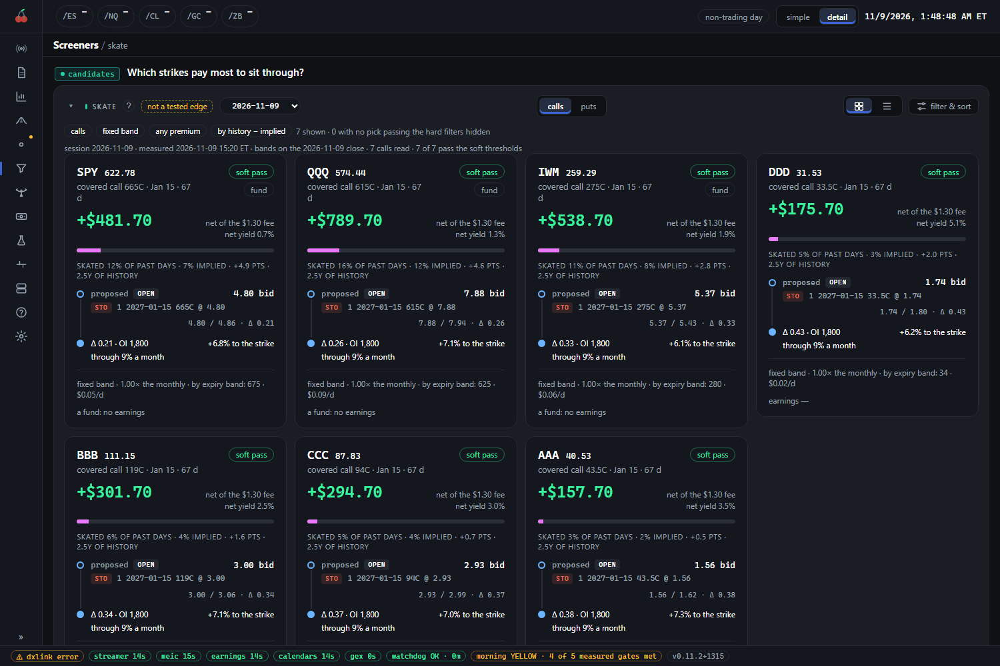
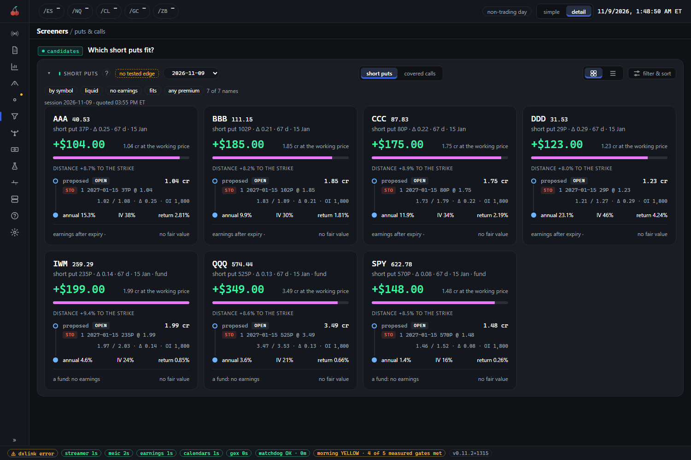

# Screeners

Screeners is where the suite lists candidates: names and option trades that fit a rule, shown for you to
judge. The page is `/screeners`, with eight tabs: `/screeners/earnings`, `/screeners/earnings-record`,
`/screeners/board`, `/screeners/skate`, `/screeners/income`, `/screeners/credit-spreads`,
`/screeners/time-spreads` and `/screeners/valuation`. The first four are screens of our own. The next four
are lists of option trades, with fair value as the odd one out. (The older addresses
`/screeners/short-puts` and `/screeners/covered-calls` open the income tab on its own list.)

## What you see

Each tab is one card with a title, a small amber flag, a `?` button and a `filter & sort` button. Most show
trade cards (a card per name, with the order that would open it written out as legs) and a switch for rows
instead. Most tabs also have a session picker for earlier days.

The screenshot is the skate tab. The flag, "not a tested edge", sits beside the title. Each card is a name
(here made-up ones such as AAA and BBB) and one proposed trade: the covered call, its strike and expiry, the
premium per contract as the big figure, the share of past days the name "skated" (stayed clear of the
strike) against the share the market implies, and the order as a leg with its bid and ask. `soft pass` means it clears the soft
thresholds.

### The screens

- **earnings** (`/screeners/earnings`) is the earnings calendar: every announcement in the next 30 days,
  by day. Each row carries the report time, our own direction read and its strength, IV rank, the expected
  move and a suggested spread with its legs. Windows `Today`, `Next 7 days` and `Next 30 days`.
- **earnings record** (`/screeners/earnings-record`) is the same calendar checked against what happened: a
  **forward check** of tiles (how often the move stayed inside the expected move, how often the direction
  was right, net on the spread) and a **journal** of every past announcement, each row opening the
  spread's money (entry, exit, gross, fees, slippage, net).
- **signal board** (`/screeners/board`) is two cards, **bullish** and **bearish**: each name with a count of
  the methods that agree on that side (stage, sector rotation, the trend scan, analyst revisions), at a
  minimum count you pick. A tie has no side and is not listed.
- **skate** (`/screeners/skate`) shows covered calls above a name's recent range and cash-secured puts
  below it, for a seller who does not want assignment. Tabs `calls` and `puts`; a band choice (`fixed` or
  `by expiry`) decides which strikes drive the cards.

### The income lists

- **puts & calls** (`/screeners/income`) has a switch between `short puts` and `covered calls`: for each name
  in the universe, the strike nearest 16 delta, priced at the working price. Put on the cycle monthly 45 to
  60 days out; call on the monthly 30 to 45 days out, for shares you hold.

  

- **credit spreads** (`/screeners/credit-spreads`): chart setups that just entered, as spreads on the 30 to
  45 day monthly. A long setup is a put spread and a short one a call spread. A card shows the chosen width,
  the credit, the maximum loss and credit over maximum loss; its other widths open from the card.
- **time spreads** (`/screeners/time-spreads`): the day's calendars and diagonals on names whose front week
  is priced rich to the back month, ordered by the front over back IV ratio. Each card says whether your
  account's sizing fits it (`fits ×1`) or which cap stops it.
- **fair value** (`/screeners/valuation`): one DCF estimate per name from the company's own annual
  statements, in views `valued`, `pmcc` and `all`. Each row shows price, fair value, **reach** and
  **stretch**. Opening a name shows the whole model.

On a new install, and on the demo, the earnings calendar, earnings record, time spreads and fair value
tabs are empty until the first nightly runs have written them. They say what they are waiting for, for
example "No calendar written yet: the earnings-calendar job runs at 19:10 ET on trading days." The skate
quotes are taken at 12:00 and 15:05 ET, the income chains at 14:45 ET (list built at 15:10), the board at
06:45 and the earnings record at 06:50.

### Which tabs need Dolt

Dolt is the free local market-data store the installer can set up. **earnings**, **earnings record**,
**signal board**, **skate**, **credit spreads** and **fair value** are built from it. If the technicals
engines are off because Dolt is not set up, those tabs say "The ... tab needs Dolt" and how to set it up:
run the installer again and say yes to the Dolt step, then the tab fills after the next evening's technicals
run. **puts & calls** and **time spreads** do not need Dolt (time spreads use broker reads only).

## How to read it

**These are candidates to judge, not signals.** Look at the amber flag on every card:

| Tab | Flag |
| --- | --- |
| earnings, earnings record | `no edge in history` |
| signal board | `not a tested signal` |
| skate | `not a tested edge` |
| puts & calls | `no tested edge` (short puts), `not refuted, not an edge` (covered calls) |
| credit spreads, time spreads | `no tested edge` |
| fair value | `no edge` |

The `?` behind each flag gives the study it rests on. For example, the earnings screen's suggested spread
lost on risk over 2020 to 2026 and its direction read called the reaction about as often as a coin. The
screens are shown because they exist and are good for finding things to look at, not as advice. The lists
are in symbol order, never ranked by yield, on purpose: a yield order would read as an edge.

**The universe is options-tradable names.** The lists draw only from names the liquidity verdict calls
**tradable**: the name lists weekly options, its stock trades at least $100M a day, and its monthly options
are confirmed liquid (a tight at-the-money spread, and open interest and volume worth enough in dollars). A
**thin** name passes the first two tests but not the third, or has not been measured yet; "unconfirmed is
not liquid". A name that fails is **not tradable**: its chart may exist, but no screener lists it. Funds that
pass the same test are included. On the Setups watchlist the same verdict is the `Options-tradable` switch.

**Liquidity also shows on each trade.** A `thin` chip on a card means that trade's own option fails the leg
bars (each leg two-sided, its spread within the bars, enough open interest), so the `Liquid trade` filter
hides it by default. An `unquoted` chip means there was no quote to judge, so it stays shown, marked.

**Other chips.** `fits` or `does not fit` is against your account's buying power (or, for calls, whether you
hold an uncovered 100-share lot). `earnings in the trade` warns of an announcement before expiry. A
`leveraged` chip is a daily-reset fund, which decays and gaps in ways its delta does not price.

**Prices are modelled.** Credits are at the working price from an afternoon reading. Re-quote before you
send anything; nothing here places an order. Money follows the suite's layout: one contract's credit or
debit, whole-position dollars, fees and slippage apart (see [money-layout.md](../conventions/money-layout.md)).

**Fair value is a description.** Cheap names did no better than rich ones in the test, so it is not a reason
to pick a name. **Reach** says whether the business has ever done what the price needs (`below value`,
`within history`, `beyond history`), and **stretch** is the margin the price needs over the company's own
best year, so under 1x is inside its record. The default order is by reach then stretch, not by the gap.
A fund, a bank or a REIT reads "no fair value".

## What to do

- Use the screens to build a short list, then look at each name's chart (`/charts/technicals`) and at the
  trade on the Live pages (see [live.md](live.md)) before doing anything with your own money.
- Leave the filters on until you know what they hide: the filter line says "n of m names" and counts each
  hidden group once, so you can see what you are missing.
- Check the session date and the quote time under the title. An old list is not today's.
- If a tab says it needs Dolt, decide whether you want it. Everything else works without it.
- Do nothing about an empty tab on a new install. It fills after its job has run.
- Do not read a long list as a lot of opportunity. None of these lists has a tested edge, so position size
  and risk limits matter more than the pick.
