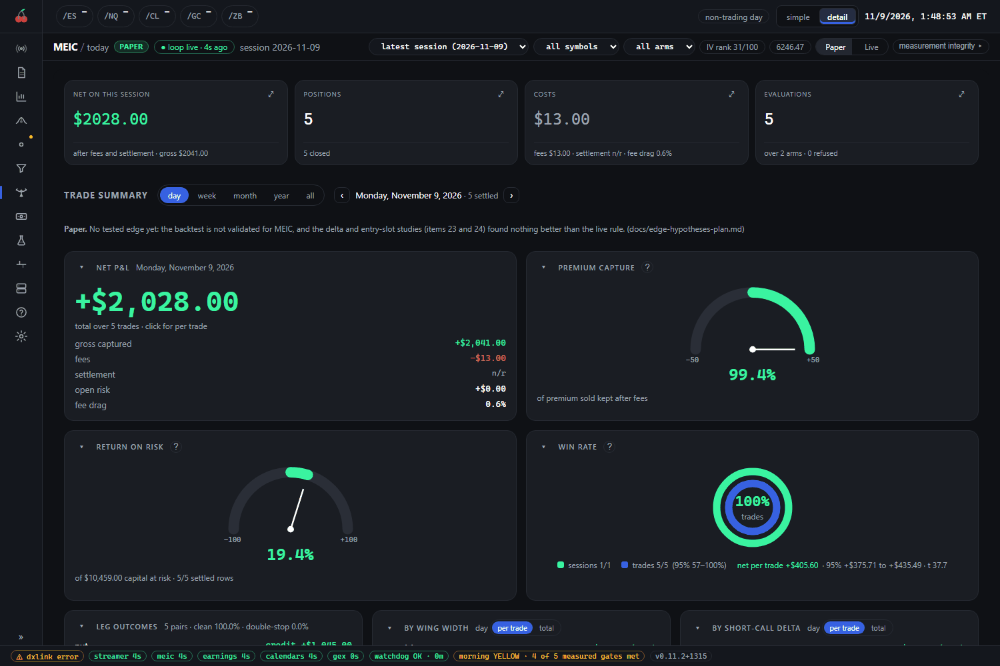
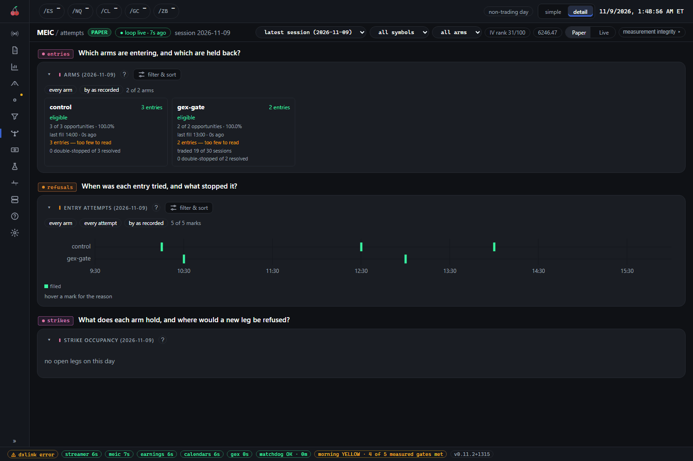
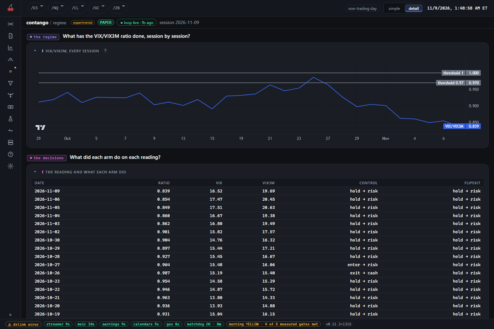

# Strategy pages

Each trading module has its own page in the console: `/meic`, `/earnings`, `/calendars`, `/contango`, `/weeklyput` and `/ensemble`. The `/experiments` page sits above them with one card per paper experiment. Four retired modules, `/flies`, `/bwb`, `/pmcc` and `/curve`, ship switched off.

## What you see

Open a module and the rail on the left lists its tabs, grouped under today, tables, evidence, study and help. Most modules share the same tabs, so they are explained once here. A tab a module does not have is simply missing from its rail.

| Tab | What it answers |
| --- | --- |
| `today` | The day at a glance: net on the session, what is open, what it cost. Each module draws it in its own terms. |
| `positions` | Every trade the module opened, entry side. |
| `history` | The closed trades: gross, then fees, settlement and slippage in their own columns, then net. The rows add up. |
| `decisions` | Every entry the module considered, with the reason it did or did not trade. |
| `arms` | One card or row per arm. |
| `performance` | Net P&L over time and the reading of each arm. |
| `analysis` | Drawdowns, a stress test, what happens with worse fills, and breakdowns. |
| `costs` | What fees, settlement and slippage took. |
| `help` | The module's rule in words. |

Two controls sit in the page header of most modules. The simple and detail switch at the top right chooses between a shorter and a full set of tabs, where a module has made that choice. Paper and Live, where a module has both, switch the ledger being read.

Here is the MEIC `today` tab as a worked example.

The four tiles across the top are net on the session, positions, costs and evaluations. Below them, the trade summary can be set to a day, week, month, year or all time. The net P&L card shows gross captured, then fees, settlement and open risk, so you can see how the net was reached. Premium capture, return on risk and win rate are the gauges beneath it.

### Arms

An **arm** is one configured variant of a module: the same strategy with one setting changed, run side by side. Almost every module has a `control` arm, the plain version, and other arms that each change one thing. The point of arms is to find out whether the change helps, and `arms` shows each one beside its control. Do not read one arm in isolation. To add or change one, see [experimenting-with-arms.md](experimenting-with-arms.md).

### Decisions

`decisions` lists each entry the module considered and the reason it was skipped, or that it entered. Where a gate refuses the same way tick after tick, that is one row with a count in the `n` or `occurrences` column, not a flood of rows. When you wonder why a module did not trade today, this is the tab to open.

MEIC has no `decisions` tab. Its equivalent is `attempts`, shown here.

The first card says which arms are entering and which are held back. The timeline plots each attempt by time; hover a mark for the reason. Earnings has a `decisions` tab, but it holds the management log of open positions: one row per action, with the reason and whether it acted. Its skipped entries are on `screening`, under the card "Why symbols were rejected".

## How to read it

- **Paper is an upper bound.** A paper fill is modelled. Nothing queues, nothing is rejected, and the price is the one the model chose. Real fills can be worse. Where a module says early assignment is measured but not modelled, the paper result is higher still than a real account would see. Treat paper as the best case.
- **P&L means net.** Gross less fees, settlement and slippage, with each in its own column. Money is whole-position dollars, and a credit is positive. See [money layout](../conventions/money-layout.md).
- **Provisional.** A trade that is not settled yet shows a `provisional` badge on its net: that figure is a mark, not a settlement, and it can still move.
- **Too few to read.** A row built on few trades or sessions is marked thin or "too few to read". It is shown, but it is never evidence. A handful of trades says nothing about an edge.
- **Live versus paper.** Only MEIC, flies and bwb have live loops, and each sits behind its own gate and a per-day arm. Every other module is paper-only or read-only. If a module has a Paper and Live switch, check which one you are looking at before you read a number; `/live` is where real positions are. See [live.md](live.md).

## What to do

- Read `today`, then `decisions` (or `attempts`) if the day looks quiet. A quiet day is usually a gate doing its job.
- Judge an arm over many sessions, from `performance` and `analysis`, never from one day.
- Don't change a setting because of a few trades. Settings are in Config: see [system-and-config.md](system-and-config.md).

## MEIC (`/meic`)

Multiple-entry iron condors on same-day-expiring index options. It is one of the three modules with a live loop. The live loop runs only while that day's arm record is valid, though it also runs unarmed to manage what it already holds. Tabs: `summary` (shown as "today"), `arms`, `forest`, `attempts`, `positions`, `history`, `sessions`, `exits`, `regime` (shown as "regime cuts"), `performance`, `analysis`, `costs`, `advisor` and `guide` (shown as "help"). The header has a Paper and Live switch, a session picker, and symbol and arm filters. `forest` is the profit forest. `exits` shows how positions end (exit reasons) and what fees take. `sessions` shows how each calendar period went, net of fees.

## Earnings (`/earnings`)

Defined-risk trades around earnings announcements, **paper-only from v0.12.0**: it places no order. Tabs: `summary` ("today"), `positions`, `history`, `decisions`, `screening`, `strategies` and `advisor`. `screening` shows the upcoming earnings scan with a tier on each name, the reasons names were rejected, and entry reviews. `strategies` compares the structures against each other, net of costs. It needs the local Dolt market data to be set up.

## Calendars (`/calendars`)

A weekly SPY double calendar, paper-only and experimental. Tabs: `summary` ("today"), `plan`, `positions`, `history`, `decisions`, `arms`, `policies`, `performance`, `analysis`, `advisor` and `guide` ("help"). `plan` is this week's plan and what the entry window did. `policies` replays each candidate exit rule over the recorded price path, so you can see which exit rule would have been worth anything without running it as an arm.

## Contango (`/contango`)

Holds a short-volatility fund while the VIX to VIX3M ratio says contango, and T-bills when it does not, deciding once a session ten minutes before the close. Paper-only and experimental. Its arms differ only in where they get out. Tabs: `summary` ("today"), `regime`, `positions`, `history`, `decisions`, `arms`, `performance`, `analysis`, `costs` and `guide` ("help").

The chart is the ratio, session by session, against the two thresholds. Below it, each row is a session: the ratio, the two index levels, and what each arm did, such as `hold -> risk`. `enter` and `exit` rows are where an arm changed what it holds.

## Weekly put (`/weeklyput`)

Sells the put nearest 10 delta on four index and fund underlyings, seven days before each weekly expiry that is not a standard monthly, and holds it to expiry. Paper-only and experimental. It is judged by the cycle, one expiry at a time, not by the single put. Tabs: `summary` ("today"), `cycles`, `positions`, `history`, `decisions`, `performance`, `costs` and `guide` ("help"). `cycles` shows what each expiry earned, name by name, and which names were missed. An in-the-money fund put near expiry is flagged assignment-exposed: early assignment is measured, never modelled, so those results are an upper bound.

## Ensemble (`/ensemble`)

A set of short-dated option structures, each placed by its own rule. An arm is one configured variant, and the arms on the page are whatever the ledger names, so one you add to the config appears with no other change. Paper-only and experimental. Tabs: `summary` ("today"), `positions`, `history`, `decisions`, `performance`, `costs` and `guide` ("help"). `summary` lists each arm that was due today as entered, pending or missed, and for one that did not enter, the check that blocked it and the value it read. `positions` draws every open structure as the order that opened it, every leg in the chain. `performance` shows each arm's net and drawdown with all the arms stacked beneath, and the net at the stress and mid fills beside it as context. P&L is net at the suite's slippage model.

## Experiments (`/experiments`)

One tab, `experiments`: a card for each of the paper experiments (PMCC, calendars, curve, contango, weekly put, ensemble) whose module is switched on, with net all time, what is open now, and links into the module's own `today`, `positions`, `history` and `performance`. A retired experiment loses its card. A last card holds the retired flies record.

## Retired modules

Each is off by default, and its page leaves the rail while it is off. Its code and ledgers are kept.

- `/flies`: Retired 2026-10-19; off by default.
- `/bwb`: Retired 2026-11-08; off by default.
- `/pmcc`: Retired 2026-11-08; off by default.
- `/curve`: Retired 2026-11-01; off by default.

To bring one back, turn its module on in Config; see [system-and-config.md](system-and-config.md). Flies and bwb have live paths, so reinstating them is a deliberate decision that you should read the module's own README before making.
