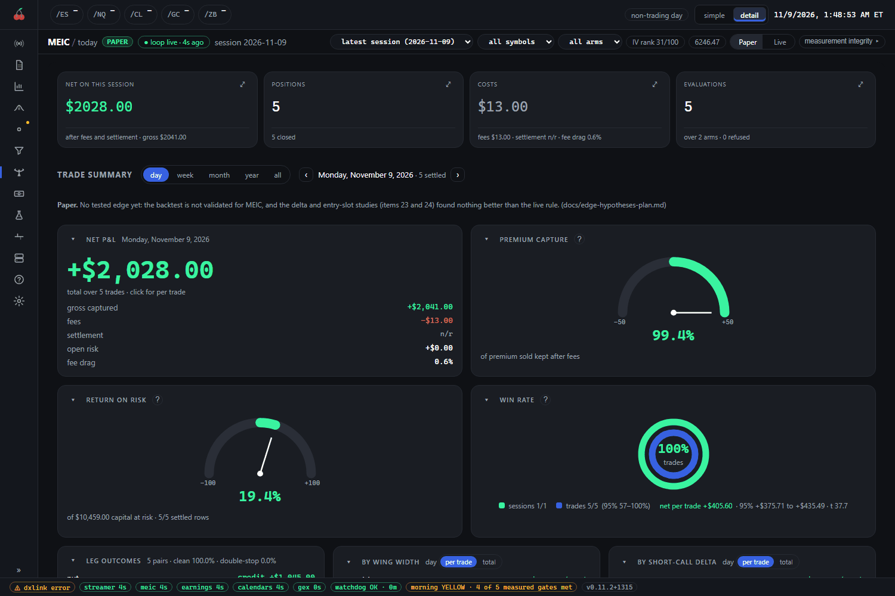
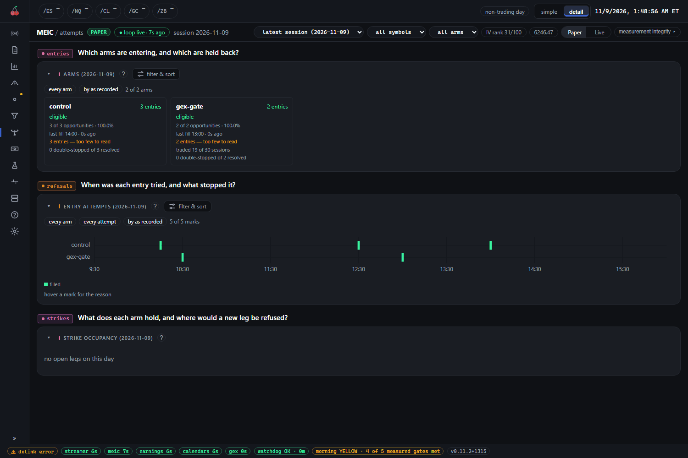
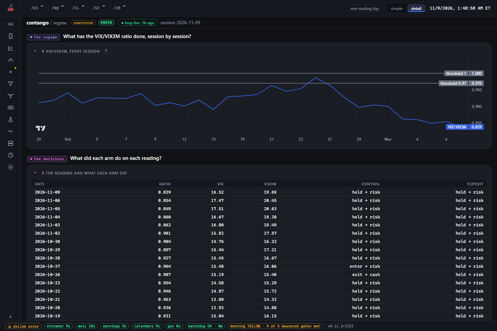

# Strategy pages

Each trading module has its own page in the console: `/meic`, `/earnings`, `/calendars`, `/contango`, `/weeklyput`, `/ladder` and `/automations`. The `/experiments` page sits above them with one card per paper experiment. Four retired modules, `/flies`, `/bwb`, `/pmcc` and `/curve`, ship switched off.

## What you see

Open a module and the rail on the left lists its tabs, grouped under today, tables, evidence, study and help. Most modules share the same tabs, so they are explained once here. A tab a module does not have is simply missing from its rail.

| Tab | What it answers |
| --- | --- |
| `today` | The day at a glance: net on the session, what is open, what it cost. Each module draws it in its own terms. |
| `positions` | Every trade the module opened, entry side. |
| `history` | The closed trades: gross, then fees, settlement and slippage in their own columns, then net. The rows add up. |
| `decisions` | Every entry the module considered, with the reason it did or did not trade. |
| `arms` | One card or row per arm. |
| `performance` | Net P&L over time and the reading of each arm. |
| `analysis` | Drawdowns, a stress test, what happens with worse fills, and breakdowns. |
| `costs` | What fees, settlement and slippage took. |
| `help` | The module's rule in words. |

Two controls sit in the page header of most modules. The simple and detail switch at the top right chooses between a shorter and a full set of tabs, where a module has made that choice. Paper and Live, where a module has both, switch the ledger being read.

Here is the MEIC `today` tab as a worked example.

The four tiles across the top are net on the session, positions, costs and evaluations. Below them, the trade summary can be set to a day, week, month, year or all time. The net P&L card shows gross captured, then fees, settlement and open risk, so you can see how the net was reached. Premium capture, return on risk and win rate are the gauges beneath it.

### Arms

An **arm** is one configured variant of a module: the same strategy with one setting changed, run side by side. Almost every module has a `control` arm, the plain version, and other arms that each change one thing. The point of arms is to find out whether the change helps, and `arms` shows each one beside its control. Do not read one arm in isolation. To add or change one, see [experimenting-with-arms.md](experimenting-with-arms.md).

### Decisions

`decisions` lists each entry the module considered and the reason it was skipped, or that it entered. Where a gate refuses the same way tick after tick, that is one row with a count in the `n` or `occurrences` column, not a flood of rows. When you wonder why a module did not trade today, this is the tab to open.

MEIC has no `decisions` tab. Its equivalent is `attempts`, shown here.

The first card says which arms are entering and which are held back. The timeline plots each attempt by time; hover a mark for the reason. Earnings has a `decisions` tab, but it holds the management log of open positions: one row per action, with the reason and whether it acted. Its skipped entries are on `screening`, under the card "Why symbols were rejected".

## How to read it

- **Paper is an upper bound.** A paper fill is modelled. Nothing queues, nothing is rejected, and the price is the one the model chose. Real fills can be worse. Where a module says early assignment is measured but not modelled, the paper result is higher still than a real account would see. Treat paper as the best case.
- **P&L means net.** Gross less fees, settlement and slippage, with each in its own column. Money is whole-position dollars, and a credit is positive. See [money layout](../conventions/money-layout.md).
- **Provisional.** A trade that is not settled yet shows a `provisional` badge on its net: that figure is a mark, not a settlement, and it can still move.
- **Too few to read.** A row built on few trades or sessions is marked thin or "too few to read". It is shown, but it is never evidence. A handful of trades says nothing about an edge.
- **Live versus paper.** Only MEIC, flies and bwb have live loops, and each sits behind its own gate and a per-day arm. Every other module is paper-only or read-only. If a module has a Paper and Live switch, check which one you are looking at before you read a number; `/live` is where real positions are. See [live.md](live.md).

## What to do

- Read `today`, then `decisions` (or `attempts`) if the day looks quiet. A quiet day is usually a gate doing its job.
- Judge an arm over many sessions, from `performance` and `analysis`, never from one day.
- Don't change a setting because of a few trades. Settings are in Config: see [system-and-config.md](system-and-config.md).

## MEIC (`/meic`)

Multiple-entry iron condors on same-day-expiring index options. It is one of the three modules with a live loop. The live loop runs only while that day's arm record is valid, though it also runs unarmed to manage what it already holds. Tabs: `summary` (shown as "today"), `arms`, `forest`, `attempts`, `positions`, `history`, `sessions`, `exits`, `regime` (shown as "regime cuts"), `performance`, `analysis`, `costs`, `advisor` and `guide` (shown as "help"). The header has a Paper and Live switch, a session picker, and symbol and arm filters. `forest` is the profit forest. `exits` shows how positions end (exit reasons) and what fees take. `sessions` shows how each calendar period went, net of fees.

## Earnings (`/earnings`)

Defined-risk trades around earnings announcements, **paper-only from v0.12.0**: it places no order. Tabs: `summary` ("today"), `positions`, `history`, `decisions`, `screening`, `strategies` and `advisor`. `screening` shows the upcoming earnings scan with a tier on each name, the reasons names were rejected, and entry reviews. `strategies` compares the structures against each other, net of costs. It needs the local Dolt market data to be set up.

## Calendars (`/calendars`)

A weekly SPY double calendar, paper-only and experimental. Tabs: `summary` ("today"), `plan`, `positions`, `history`, `decisions`, `arms`, `policies`, `performance`, `analysis`, `advisor` and `guide` ("help"). `plan` is this week's plan and what the entry window did. `policies` replays each candidate exit rule over the recorded price path, so you can see which exit rule would have been worth anything without running it as an arm.

## Contango (`/contango`)

Holds a short-volatility fund while the VIX to VIX3M ratio says contango, and T-bills when it does not, deciding once a session ten minutes before the close. Paper-only and experimental. Its arms differ only in where they get out. Tabs: `summary` ("today"), `regime`, `positions`, `history`, `decisions`, `arms`, `performance`, `analysis`, `costs` and `guide` ("help").

The chart is the ratio, session by session, against the two thresholds. Below it, each row is a session: the ratio, the two index levels, and what each arm did, such as `hold -> risk`. `enter` and `exit` rows are where an arm changed what it holds.

## Weekly put (`/weeklyput`)

Sells the put nearest 10 delta on four index and fund underlyings, seven days before each weekly expiry that is not a standard monthly, and holds it to expiry. Paper-only and experimental. It is judged by the cycle, one expiry at a time, not by the single put. Tabs: `summary` ("today"), `cycles`, `positions`, `history`, `decisions`, `performance`, `costs` and `guide` ("help"). `cycles` shows what each expiry earned, name by name, and which names were missed. An in-the-money fund put near expiry is flagged assignment-exposed: early assignment is measured, never modelled, so those results are an upper bound.

## Ladder (`/ladder`)

Buys a lot of a leveraged index fund (TQQQ and SOXL) when it trades 7% under a reference price and sells each lot on its own at 4% over what it cost, with no stop and no time limit. Arms run side by side, each an entry rule (`session`, `chain` or `once`) with a target rule (`fixed` or `decay`), as the ladder's config declares them; `session` with a fixed target is the Discord group's own rule. Paper-only and experimental, and not a tested edge: the rule failed its tests on daily and minute bars, and the help tab gives the verdicts. Tabs: `summary` ("today"), `positions` ("open lots"), `history`, `arms`, `decisions` and `guide` ("help"). Today shows each fund's previous close and where every arm would buy next, with how far the bid is from that level. Open lots flags any lot held past 18 days as the group's "hospital"; it is counted, never acted on. History lists the sold lots, and a row opens to the buy and the sale as an order. Arms describes each arm from the config and adds up its realised and unrealised result and its 18-day counts.

## Automations (`/automations`)

A set of short-dated option structures, each placed by its own rule. An automation (an arm, in its config) is one configured variant, and the ones on the page are whatever the ledger names, so one you add to the config appears with no other change. The old address, `/ensemble`, opens this page. Paper only, on the rail's Modules section after Earnings (shortcut `5`). Tabs: `summary` ("today"), `groups`, `positions`, `history`, `decisions`, `performance`, `costs` and `guide` ("help").

`groups` sets which automations trade, in three levels. **Every group:** how many automations are on, waiting on a start, off by their group or off by their own switch, and a row per group (and one for the automations in no group) with its switch, members, budget, research verdicts, open positions and net, a **Switch on/off** and **Open**; a new group starts off. **One group:** its switch, start, allocation and max risk, then each member with its own switch, the state it is in, its verdict, its share, and **Move to**; **+ Add automations** brings others in. **One automation:** the three things it needs to trade (its group on, its own switch on, its start come), each ticked or not, which group it is in, the rule in plain English with each block's backtest label (**View in Builder** opens it, read-only), its verdict and its paper record, and the trade's shape beside a chain example, as the Builder shows them under the legs. An automation in no group answers to its own switch alone. Every change waits in the bar along the bottom as you move between levels; **Review** lists each one (what it was, what it becomes, **Undo**), asks the automations module what it does to trading (who starts, who stops, and any starting that failed their research), and **Save** writes them together to the automations config, with a backup. Anything switched on starts at the next session, never mid-day; one with a forward rule keeps its start. Paper only. `summary` lists each arm that was due today as entered, pending or missed, and for one that did not enter, the check that blocked it and the value it read. `positions` draws every open structure as the order that opened it, every leg in the chain. `performance` shows each arm's net and drawdown with all the arms stacked beneath, and the net at the stress and mid fills beside it as context. P&L is net at the suite's slippage model. The bottom of `summary` lists the automation groups: whether each group is switched on, and each automation with its research verdict (the `ensemble` group's eight carry item 75's: passed, failed or no verdict). A group that is off enters nothing; what it holds is still managed.

## Builder (`/automations/builder`)

Automations' `builder` tab, beside `groups`: build an automation here, then switch it on in its group. `/builder` and its links come here, and `g u` opens it. A forward test is not a backtest, so it sits apart from Backtest. One automation at a time: **Open** picks a saved one (read-only, as every saved one opens), **New** starts one, **Copy as new** starts one from the saved automation open. A copy is not backtested whatever it was copied from. The bar under it holds the name (lower case letters, digits and hyphens), the automation's switch, group, start date and register label, and **Open every section** and **Close every section**.

**This automation** says the whole automation in one paragraph, each value you set marked, beside the trade's shape. It is the automations module's own sentences, filled in, so Groups shows the same words. Under it: **Check**, **Save (off)**, **Today, live** and **Edit as JSON**. For a new automation, a strip says what comes after the save: an explore run, adding it to a group, and switching it on from the next session.

Five numbered sections follow, each closing to its sentence with its state: `editing` while open, else its block's backtest label (`backtested` while it stands as the research study ran it, `changed since its backtest` once edited, `not backtested` when no study ran it). A new automation or a copy opens at section 1; **Next** closes a section and opens the one after. Each line is a sentence with a box or a choice where each value goes, worded by the automations module, never by the page. A choice with a default shows its default chosen and writes nothing until changed. **More options** under a line holds the settings the line leaves out, each in its own phrase, and says how many are set. A **?** beside a part opens a short note on what it means.

1. **Trade.** A strategy rail on the left (one option, spreads, both sides, two expiries, stock, then Custom) fills in the legs and the expiry. The strategy's line reads as the trade (Sell an iron condor on SPY with short strikes at 0.16 delta and wings 5 points wide), and changing a value in it rebuilds the legs at once, keeping the expiry line's rule. Picking a strategy over legs of your own asks first. Below it: **Expiring** (the expiry rule, its kind then its days; with `monthly` set, only standard monthlies), **On** (the weekdays), **Skip** (the events to skip, by name, as tags with **+ Add an event**), and **More expiry options** (tolerance, monthlies, a far expiry, and what each event is and when it next falls). **The legs it makes** shows each leg read-only in columns (leg, action, qty, side, its expiry once there are two, strike, placed by, from, match) until **Edit legs** turns them into boxes; an edited leg makes the trade Custom (from the strategy), its line greyed with **Rebuild from …**, which asks first. Under the legs, the trade's shape beside a chain example.
2. **Entry.** An entry preset rail (time, trend and mean reversion, intraday, events, then Custom) fills in the entry; picking one over an entry of your own asks first. **Enter** chooses at a time, an opening-range break, or on a trigger (a fixed time, or a signal's first firing in a window). A signal reads as its sentence: its kind grouped (indicators, price, the open, levels, calendar), and each indicator as a pill (price, an average, VWAP, RSI, stochastic, MACD, volume, a previous high or low, the opening range), each with its own settings, or a number. **Between** sets the window and when it enters. **Only if** adds conditions that must hold when it fires. **More options** holds the firing rules (confirm, re-arm, once a session, no later than), the signal's own (warming its reading on earlier sessions), daily bars and the bar width. **Edit as rule** shows the entry as the engine reads it, editable. A time entry that misses the 15:59 chain our monthly history holds says so.
3. **Filters.** Every filter must pass. Each is a line (VIX is between 14 and 30; RSI(14) is at most 30) with a tag for when it is read: before the order, on the chain, or on the priced trade. A band left blank on one side reads at least or at most. **+ Add a filter** opens the filters by group (price move, trend, volatility, dealer positioning, the trade's price, other automations), each with a line on what it reads. An entry preset's filters land here as ordinary lines.
4. **Exits.** It closes at the first exit reached; none set holds it to expiry. Start from the module's **Credit-trade rules** (offered unless the trade enters for a debit) or **Hold to expiry**; anything else reads Custom, and replacing your own exits asks first. **Profit**, **Loss**, **Time** and **Events** each have a row with a switch and their exits as lines, more than one where you want them (a stop at a multiple of the credit and a dollar stop together; the first reached closes it). Whether the trade enters for a credit or a debit is read from its legs by the automations module, and a stop it cannot fire is not offered. An event exit lists its events as tags. **More options** holds the price, signal and guard exits: a touch of a level, a delta limit, a signal (the entry's own lines), and waiting out wide quotes. **Edit as rule** shows the exits as the engine reads them; it stays closed while the lines show everything, and opens by itself, naming what they cannot show, when the exits set something more.
5. **Size and limits.** **Size** by contracts, a risk budget or a share of an allocation, then **Limits**: how many open at once and one a day. **More options** holds the minimum, the caps, spacing between entries, one per expiry, and stepping the size after a run of losses or wins. Fills and fees are paper's, not set here.

The **strategies** are option, vertical, butterfly, broken-wing butterfly, ratio spread, straddle, strangle, iron condor, iron fly, jade lizard, calendar and diagonal, each with the settings it takes: short or long, put or call, DTE and which expiries, how the first strikes are placed (delta, % from the spot, standard deviations or points) with its target, the width, and a broken wing's far wing or a ratio. The automations module writes the legs (L1, L2, …, by the engine's own strike rules) and the expiry rule. A calendar or a diagonal adds the far expiry and the close before the near one. Covered call is listed but waits for stock legs.

A leg added here takes an ID (L1, L2, …) that it keeps: a removed one is not given again, and a new leg takes the next number. It reads as its ID and its words, L2 · Short Put, and the pickers that place one leg from another list it that way. A leg of an automation saved before IDs keeps its name, shown in words (`short_put` reads Short Put). Two legs may not share a name. A leg is saved in the same words, `action` (BTO, STO), `qty` and `side` (put, call), so a 1-2-1 fly is three legs; an automation saved in the older spelling (`side` as signed contracts, `right` as C or P) still reads, and is written in the new one the next time it is saved; fees and slippage count each contract, and the settlement charge is per strike, as the broker charges it.

The **shape** is drawn from the rule alone, with no session or price: each leg named where it sits, at its distance from the spot (spot is 0) or at its delta (Δ0.30, Δ0.30 +15), a leg of more than one contract marked larger, and the y axis in words (max profit, 0, max loss), never dollars. Where a leg is placed by delta or a multiple, the order is true and the spacing is not, and the line under it says so. The **chain example** beside it is where the rules land on a real chain: each row by its distance from the strike nearest the spot (0 · spot), each side's delta, and every leg marked on its own side as the order that opens it, as an order chain writes it (STO 2 · L2 · Short Put; BTO for a bought leg; the full words on hover). The line above it begins "For example", with the session it came from, the credit or debit at the mid and the most it can make and lose. The automations module places the legs by the automation's own rules, as its decision would (an unsaved edit as it stands, after a short pause): on live quotes when the stream cache holds them, else on the last session our own recorder holds, at the first stored minute of the entry window. A later expiry is placed on live quotes only, since our own stores hold no intraday chain for one; out of hours the chain says so and the shape still shows. On a phone the two stack.

Every choice comes from the engine's own tables, so the page offers nothing the engine would refuse by name. Whether a value is right is the **Check**, which lists each problem, or updates each section's label and says whether our data covers a backtest. **Edit as JSON** shows the same automation as text, for anything the lines do not lay out.

For a saved automation not wholly backtested, a line above the summary says whether our data covers a backtest over the last year (a time entry whose window holds 15:59 reads the end-of-day chains; any other reads minute data), or names the nearest store and why it falls short, or that none of our stores holds that kind of expiry. A store written the next morning is a session or two behind; up to five trading days behind still covers, and the run ends at the store's last session. A rule allowing any expiry needs weeklies, which only the vendor holds; where monthlies would be covered, the line says so. Our own recordings are asked first. Where they fall short and the vendor licence allows new work, the vendor's store is offered instead, and the line names it and says the result is licensed: it stays on this machine and shows only while licensed results may.

For an underlying outside the full set's seven that our data does not cover, the line below offers **Add it to the full set**. It shows first what the addition would fetch (requests and sessions, from a year back by default, at the vendor tier's requests at a time), then **Add and backtest** queues those fetches on the vendor's queue and this automation's explore run after them, so the click runs through to a result. One click adds at most 300 sessions, and only while the vendor licence allows new work; the data and the result are licensed. A longer span is added by hand with the full set's script.

- **Check** asks the automations module whether the paper loop would accept the automation.
- **Save (off)** writes it through the suite's config editor, with a backup, and always off.
- **Today, live** decides the automation now, as paper would, and shows every check it read.

Under a saved automation's sections:

- **Explore run** queues one run of the saved automation on the research queue, over the window picked beside it. Each choice is a span one store holds for every part of the automation: the last year, and everything that store holds, ours first. A thin span (Dolt before 2025, about three days a week) says so, and the vendor's store is offered only where it reaches further back than ours, marked licensed. The line under the picker says what the chosen store holds. It is offered only for a saved, unedited automation some store covers. The run is descriptive (no verdict), changes no label and turns nothing on. It waits on the research queue behind the full option set's fetch.
- **Declare…** and **Promote to paper** are shown disabled. A study declaration is written and reviewed outside the page, and turning an automation on is a hand edit or its group's switch.

### Ideas

Beside the explore runs, **Find ideas** searches the automation's newest explore run with at least 120 sessions traded for entry filters worth declaring. It never changes the automation. The split is fixed when the search is queued, two thirds of the way through the run, and the search reads only the sessions before it.

Each filter skips days: the prior close's VIX, RSI, trend or move in a band, VIX over realised volatility, the opening gap, a weekday or an event day, alone or two at once. Skipping days raises P&L only if they lost, so a filter is scored by what it skips. The table lists each filter tried with the share of days it skips, the skipped days' net per day and its interval, the P&L it would have gained, and that gain after the search's own luck is taken off. It also shows how it ranks against random filters across the whole menu (not just random sets of its size), whether its neighbouring bands agree, how many of four folds it lost in, and whether the days it keeps still pay at 1.5x costs. The head of the table says how many were tried and how many survive Holm and BH over that count.

A filter that passes every check offers **Declare**, which drafts its register row with the split fixed (shown for copying into the register, with its mechanism added by hand). Once declared, **Test once on held-out** reads the later sessions for that idea, one time; the search logs every use of the held-out part. A filter the later part could not detect says **Not testable on our history**. Others name the checks they missed.

### Settings

**Try settings** asks the opposite question: not which days to skip, but which exits and width to use. It replays the automation as its newest explore run with at least 120 sessions traded did, and beside it the same automation with one setting changed: a stop at 1, 1.5, 2 or 3 times the credit on a credit trade such as a condor, or at 25, 50 or 75% of the debit on a debit trade (both where the legs don't say which, as on a calendar), a profit target at 25, 50 or 75%, a close 15, 60 or 120 minutes before expiry (7, 14 or 21 days on a later expiry), the width at half, one and a half or twice, and each exit it already sets switched off. Its own value on each is the base, not a candidate. Each setting is a full replay, so a grid waits its turn on the queue and takes a while.

The split is fixed when the grid is queued, as for Find ideas, and the grid reads only the sessions before it. A setting is scored by what it changes: each session's net with it less the automation's own. The list gives each setting the days it changed, the change per day and its interval, the gain and that gain after the grid's own luck is taken off, how it ranks against random changes across the whole grid, whether its neighbouring settings agree, how many of four folds it gained in, and whether the gain holds with fees and slippage at 1.5x. A setting that changed too few days, or that the automations module's check refused, is named as not scored. **Declare** and **Test once on held-out** work as for ideas.

Beside the form:

- **Today, live** decides the automation now as the paper loop would, on today's stream cache (an unsaved edit as it stands), without writing anything. It lists every check with its value and result, and the legs it would take in the order chain or the check that would stop it.
- **Explore runs** lists the automation's runs: how many versions were tried, each queued run with its state, and each finished one by its time, with what it changed from the run before, its trades, P&L and a small curve. Opening one shows its run card:
  - P&L, net at mid (the same trades filled at mid, so P&L before slippage, shown as context), trades, per trade, win rate, max drawdown and net over drawdown;
  - the cumulative P&L with its gross line and drawdown;
  - each year's gross, fees, settlement, slippage, P&L, net at mid and drawdown;
  - how it holds up, read from the same trades and never a verdict: how much of the P&L the 5 best days carry and what the other days average; P&L per trade with fees and slippage at 1.5× and 2×; the drawdown range when the trades are reshuffled, beside the actual one; and how many quarters were profitable, counting only quarters with 10 or more sessions traded;
  - why sessions were skipped, what the run changed, and its trade log.

  A run over licensed data is shown only while licensed results may be.

A forward test is the automation running on paper, which is turned on outside the page.

## Experiments (`/experiments`)

One tab, `experiments`: a card for each of the paper experiments (PMCC, calendars, curve, contango, weekly put) whose module is switched on, with net all time, what is open now, and links into the module's own `today`, `positions`, `history` and `performance`. A retired experiment loses its card. A last card holds the retired flies record.

## Retired modules

Each is off by default, and its page leaves the rail while it is off. Its code and ledgers are kept.

- `/flies`: Retired 2026-10-19; off by default.
- `/bwb`: Retired 2026-11-08; off by default.
- `/pmcc`: Retired 2026-11-08; off by default.
- `/curve`: Retired 2026-11-01; off by default.

To bring one back, turn its module on in Config; see [system-and-config.md](system-and-config.md). Flies and bwb have live paths, so reinstating them is a deliberate decision that you should read the module's own README before making.
