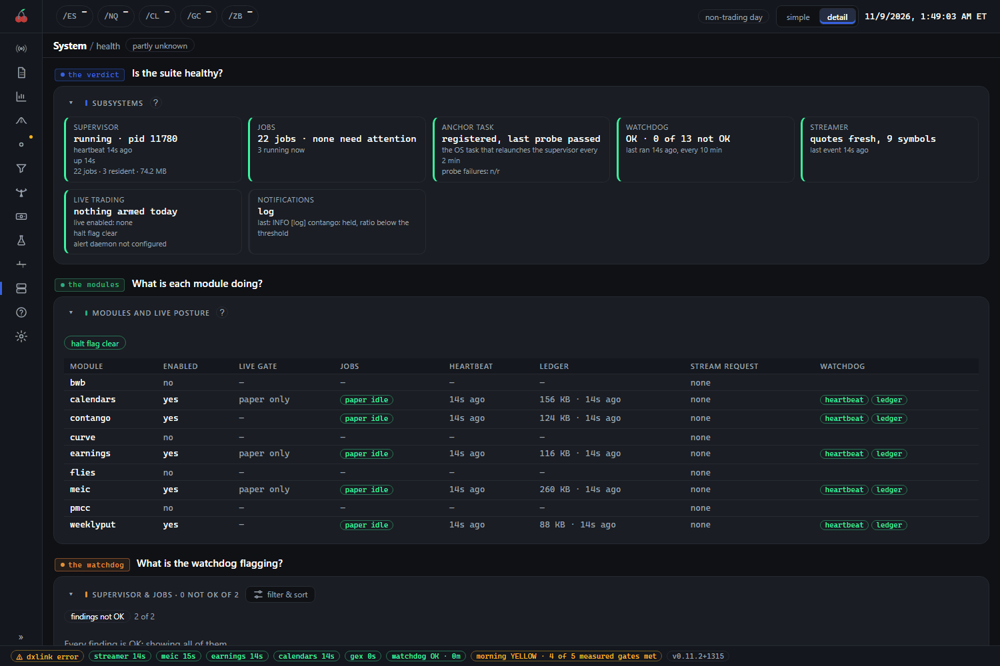

# System and Config

System at `/system` tells you whether the suite itself is healthy. Config at `/config` is where you change how it behaves, including the one control that stops live trading.

## System (`/system`)

System is read-only. It has five tabs: `health` at `/system/health`, `supervisor`, `data`, `environment` and `logs`.

### What you see



`health` opens with the verdict: supervisor, jobs, the anchor task that relaunches the supervisor, the watchdog, the streamer, live trading and notifications, a card each with a coloured edge. Under it, "modules and live posture" has a row per module: whether it is enabled, its live gate (`paper only`, or a dash where the module has none), its jobs, the last heartbeat, how big its ledger is and how long ago it was written, and any stream request. The watchdog cards list what it is flagging, if anything.

The other tabs are the detail behind it.

- `supervisor`: whether the supervisor is alive, anything that needs attention (a held job, a pending restart, a registry error), and the daemons and jobs it runs, with a state for each.
- `data`: freshness, meaning when each scheduled file last landed and whether its own run said ok, the stream cache, storage left, and any store the console failed to read. It also holds the recorded-data checks.
- `environment`: the machine and runtime, the code the suite is running, and the installed packages. A process whose source changed on disk after it started shows `restart to update`.
- `logs`: the suite's own log, which you can filter by source, number of lines and level.

### How to read it

- Green is fine. The page says "partly unknown" in its header when it could not read everything, and that is not the same as broken.
- **Live trading: nothing armed today** is the normal state outside a live session. It shows which modules have live enabled and whether the halt flag is set.
- A stale heartbeat or ledger on a module that should be running is what to look at first. A module that is switched off shows dashes, which is correct.
- The console never fixes anything from here. It reports.

### What to do

If `health` is green, do nothing. If something is flagged, open the tab that names it, then see the *troubleshooting* guide. If a process shows `restart to update` after you updated the suite, restart that job (see "Config that is read only at start" below).

## Config (`/config`)

Config edits the suite's settings from the browser. Its tabs follow the groups of settings: `arms` at `/config/arms`, `modules` ("modules & symbols"), `timing` ("timing & cadence"), `notify` ("alerts"), `rules` ("position rules") and `prefs`. Config is never hidden, because its module switches are how a switched-off module comes back.

### What you see

At the top of every Config tab, above the settings, is the halt control: a banner reading either "Live entries permitted" or "Live entries halted", with a row of chips beneath it for each module showing `paper only`, `live enabled` or `unknown`, and for flies whether it is armed today.

Below that are the settings for the tab you are on.

- `arms`: which arms run each session, one switch each. Every enabled arm is evaluated every tick, and this switch, not any "active" name, decides what runs.
- `modules`: which modules the supervisor drives, and the symbols each trades. Off means the supervisor stops driving that module entirely: no loop and no scheduled jobs.
- `timing`: entry windows and loop pacing. A change lands on the supervisor's next pass; no reinstall.
- `notify`: where alerts go and how often the scheduled checks run. Webhook addresses are kept in the keyring, not in a file, so this only picks channels. See [discord.md](discord.md).
- `rules`: the daily position evaluation behind the `/live` positions and portfolio tabs. It is advice only and never places an order. Changes apply at the next evaluation.
- `prefs`: this browser's own display choices: theme, dense tables, and whether module pages open on live rather than paper. These save at once and reach nothing else.

### The halt toggle

The halt flag stops **new live entries** everywhere. Every live loop checks the same flag file within a tick. Positions that are already open keep following their normal exit rules, so halting does not close anything. It is one click, because a stop that takes two steps arrives late. It does not go through the config editor; it writes a flag file, so it still works if the config model cannot be read.

Clearing the halt takes more: choose "Resume live entries...", then type `RESUME LIVE` exactly and press "Clear the halt". The friction is deliberate, since this is the direction that lets money move. Clearing it arms nothing on its own. Each module's live gate and its per-day arm still decide whether it trades, and you arm a live loop from its own start command. Config cannot arm live trading, in either direction.

### Saving, and how edits are made

Nothing is saved as you type. Edited fields are staged, a bar shows how many unsaved changes there are in that file, and "Save" writes them as one change. A header chip counts unsaved changes across tabs, with a "discard all" button.

**Every edit goes through the orchestrator's own config editor.** It backs up each file before writing, tells you where the backup is, and refuses the guarded live-trading fields. If the file changed on disk after the page loaded, it reloads the page and asks you to check your edits and save again. If a file cannot be read, its fields say it is not editable rather than guessing.

### Config that is read only at start

Most changes are picked up on their own, on the next tick or supervisor pass. Some long-running jobs read their config once, when they start, and keep what they read until they are restarted. A change to a setting such as a cutoff time will not reach such a job until you restart it:

```
python packages/orchestrator/run.py restart <job>
```

`<job>` is the job's name as `health` or `supervisor` shows it. A trading job keeps its state in its ledger, so a restart usually costs a tick, not a day. If you are not sure whether a setting takes effect now, restart the job that uses it.

### What to do

- Change one thing at a time, and write down what you changed and why.
- Don't change timing or arms mid-session unless you mean to. Batch measurement-affecting changes to a clean boundary, such as the start of a week, or the arm's results mix two rules.
- When in doubt, halt first. Halting is free and reversible.
- Don't edit the config files by hand while the console is open on them. The editor's backup and conflict check exist for that reason.
