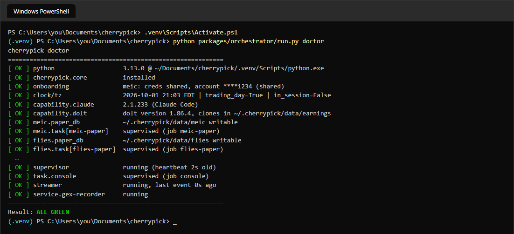

# Troubleshooting and recovery

When something looks wrong, work from the cheapest check to the dearest: ask the suite (`doctor` and
`status`), read the log, then fix the one thing it names. This page covers those two commands, where the
logs are, the failures people hit most, restarting the supervisor, and what to do after an outage.

Run every command from the folder you installed into, with the virtual environment active (see
[QUICKSTART.md](../../QUICKSTART.md#running-cherrypick-commands-yourself-the-virtual-environment)).
Nothing on this page places an order, and `doctor` and `status` are read-only, safe to run any time.

## Ask the suite first

### doctor

```
python packages/orchestrator/run.py doctor
```

It checks Python, the configuration, the broker login, the quote feed, the databases and the scheduler,
and prints one line each.



Each line starts with a mark and ends with the finding:

| Mark | Meaning |
| --- | --- |
| `[ OK ]` | Fine. |
| `[WARN]` | Worth fixing, but nothing is stopped by it. |
| `[FAIL]` | Something that should be running is not, or cannot work. Fix it. |

The last line is the verdict: `ALL GREEN`, `WARNINGS (non-blocking)` or `FAILURES`. `doctor --fast`
skips the one check that logs in to your broker, and is the quick version.

The lines you will meet most:

- `supervisor`: whether the thing that runs every job is alive. `FAIL` here explains almost every other
  problem, because a dead supervisor stops every job at once.
- `supervisor.anchor`: the scheduled task that restarts a dead supervisor. If it is missing, nothing will,
  and the fix is to run the installer again.
- `broker/keyring`: whether the saved tastytrade login still works.
- `streamer`: whether the live quote feed is running and recent.
- `earnings.dolt`: whether the Dolt server is up and serving its three databases (only with Dolt).
- `windows_update`, `service`: see [always-on-machine.md](always-on-machine.md).
- `backup`: warns when the nightly backup is more than 36 hours old.
- `notify.channels`: which alert channels are set up.

A `[WARN]` for a module that is switched off, or "outside window" for a loop that only runs in the
session, is normal.

### status

```
python packages/orchestrator/run.py status
```

It prints JSON, which looks like a lot but has a few fields worth reading.

- `supervisor.supervisor.running` should be `true`, and `heartbeat_age_seconds` small (the supervisor
  writes it every few seconds; over 90 counts as dead).
- `supervisor.anchor` shows the scheduled task exists and when it last ran with `Last Result` `0`.
- Under `jobs`, one entry per job. For each, read:
  - `enabled` and `enabled_reason`. A job that is off with a reason is healthy.
  - `schedule`, and `next_run` for an interval job.
  - `last_start` and `last_exit_code`. Zero is a clean finish.
  - `consecutive_failures` and `backoff_until`. A job that keeps failing waits longer between tries,
    up to ten minutes, so it cannot loop hot.
  - `missed` on a daily job: the time it was due passed before the supervisor could run it.

`python packages/orchestrator/run.py ps` is the shorter view: every job and daemon by name, with its
running process, whether it is held, and its last exit.

The console shows the same under **System** (`g s`): see [system-and-config.md](system-and-config.md).

## Where the logs are

Everything is under `.cherrypick/logs` in your home folder (`C:\Users\you\.cherrypick\logs` on Windows).

| File | What is in it |
| --- | --- |
| `supervisor.log` | The supervisor starting, stopping, restarting a job, and catching up one it missed. |
| `watchdog.log` | The ten-minute health check's findings. |
| `jobs/<job>.stderr.log` | What a job printed when it failed, one file per job, newest at the bottom. |
| `<module>/` (such as `meic/`) | A module's own log files. |
| `streamer/streamer.log` | The quote feed's connection and login messages. |
| `console/console.log` | The console's own log. |
| `service/` | The Windows service's wrapper logs, when service mode is on. |
| `notify.log` | Alerts sent, and where. |

The console's **System → logs** tab shows the suite's own log with filters. Finished months are
zipped into `logs/archive` on the first of each month.

**To read a failed job:** find it in `status` with a non-zero `last_exit_code`, then open
`logs/jobs/<job>.stderr.log` and read the last screen. The error is usually plain: a missing login, a
network failure, a file that is not there. Two exit codes are not errors of the job itself: `-3` means
the supervisor did not start the process and could not learn how it ended, and `-4` means a long-running
loop stopped within seconds of starting. Look at the log for what it said.

## The usual failures

### The console does not answer on port 5070

Open `http://127.0.0.1:5070`. If it does not load, wait a minute and refresh, because the supervisor
restarts the console if it dies. Then:

```
python packages/orchestrator/run.py status
python packages/orchestrator/run.py restart console
```

If `status` shows the supervisor is down, fix that first (below). If the console job keeps failing, its
log says why, in `logs/jobs/console.stderr.log` and `logs/console/console.log`. A program that is already
using port 5070 will stop the console from starting; `restart console` reports it and never kills it.

### The supervisor is down

Signs: `doctor` shows `supervisor` as `FAIL`, `status` shows `running: false`, or the heartbeat is more
than 90 seconds old.

```
python packages/orchestrator/run.py ensure-supervisor
```

That starts it if it is dead. The scheduled task does the same every two minutes, and sends one CRITICAL
alert (`supervisor.down`) after three misses in a row. If it will not stay up, read the end of
`logs/supervisor.log`. If `supervisor.anchor` is missing, run the installer again: it is safe to repeat.

### A job did not run because the machine slept

A sleeping computer runs nothing. When it wakes:

- **Jobs that run every few seconds or minutes** fire once at once and carry on. There is no burst of
  catch-up.
- **Jobs that run at a fixed time** run late if they are still inside their catch-up window, or are
  recorded as `missed` and skipped. The morning pack, for example, catches up for 90 minutes, so a wake
  at 09:00 still gets it, and the review jobs catch up for hours.

To check the machine slept, open Event Viewer → Windows Logs → System and look for *Kernel-Power*
event 42 around the gap. Then re-run only what you need. A daily job that is not running runs once now:

```
python packages/orchestrator/run.py restart morning-factpack
```

The job's name is the one `status` shows. Running a job again is safe: it neither raises an alert nor
changes its next scheduled run. To stop it happening again, see [always-on-machine.md](always-on-machine.md).

### The broker login has expired

Signs: `doctor` shows `broker/keyring` as `FAIL`, the `streamer` chip goes red and stays red, or
`logs/streamer/streamer.log` says `Missing credentials`. Store the login again:

```
python packages/orchestrator/run.py connect
```

It asks for the client secret and refresh token (see step 3 of [QUICKSTART.md](../../QUICKSTART.md)),
and hides what you type. If you revoked the token on tastytrade's site, create a new one there first.
Then restart the feed so it logs in again:

```
python packages/orchestrator/run.py restart streamer
```

### The quote feed is stale

During market hours, `python packages/streamer/run.py --status` should show `"running": true` and a
small `oldest_event_age_s` (seconds). Running with a large age is a connected but silent feed, which
is the failure to look for. The watchdog restarts a feed that has been silent for four minutes, and
that clears most stalls. Right after a restart, wait a minute before reading it.

If it goes stale again and again, the cause is the login or the network, not the feed. Check the broker
login (above) and `logs/streamer/streamer.log`. Outside 09:15 to 16:00 an old event age is normal.

If you add a symbol to a module, the feed picks it up only at its next start. Restart it once:
`python packages/orchestrator/run.py restart streamer`.

### Dolt is down

This applies only if you installed Dolt (earnings and technicals). `doctor` shows `earnings.dolt`
as unreachable or missing its databases. A supervisor job checks every five minutes and starts the
server if port 3306 is down. To do it now:

```
python packages/orchestrator/run.py restart dolt-server
```

To look at the data by hand, use `python packages/orchestrator/run.py dolt-sql <database> --query "..."`
and not a bare `dolt` command in the data folder, which can break the server's hold on its files when
the suite runs as a Windows service.

### Alerts are not arriving

```
python packages/orchestrator/run.py notify-test
```

If nothing arrives, store the webhook again with
`python packages/orchestrator/run.py secrets-set --channel discord`. See [discord.md](discord.md).

### A setting did not take effect

Some long-running jobs read their settings only when they start. Restart the job
(`python packages/orchestrator/run.py restart <job>`). See "Config that is read only at start" in
[system-and-config.md](system-and-config.md).

## Restarting the supervisor

The supervisor reads its job table once, when it starts. After you update the suite, or edit a setting
that adds or removes a job, restart it so it reads the new code and the new table:

```
python packages/orchestrator/run.py supervise --restart
```

This needs no administrator rights. The supervisor exits and is started again, by the Windows service
(about thirty seconds, sometimes up to a minute) or, without the service, by the two-minute scheduled
task. `supervise --stop` on its own leaves it stopped until that task or an administrator starts it, so
use `--restart` unless you mean to stop it.

Afterwards, check that it is back: `python packages/orchestrator/run.py status` should show
`running: true` and a fresh heartbeat. `doctor` has a line, `supervisor.jobs`, that warns when config
declares a job the running supervisor never loaded; the fix it names is a restart like this one.

To start or stop one thing and not the whole supervisor, use `restart`, `stop` and `start` with the
job's name (`ps` lists them). A stopped job is held until you `start` it, and a hold left more than 12
hours raises a warning.

## After an outage

An outage is any time the machine was off, asleep or offline over market hours: a power cut, a router
failure, a closed lid. When it is back:

1. **Check the basics.** `doctor`, then `status`. The supervisor should be running.
2. **Let it catch up.** Interval jobs resume, daily jobs inside their catch-up window run late, and the
   hourly settle job looks for anything left open. Most of the suite heals without you.
3. **Look for what is still open.** Read Reports → eod once the review builds, and **System → health**.
   A module that was down shows as "did not tick" on the review. Check that the day's data are not
   just partial: a gap in the quote record cannot be refilled.
4. **MEIC paper positions that were open across the close** settle themselves the next time its loop runs, at
   the session's official close and no other price. If there is no official print yet, the trade stays
   open and the loop tries again. An open row is honest; a settlement at a guessed price is not.
5. **If you trade live, check the account.** Live positions exist at your broker whatever the suite
   was doing. Look at the Live page and at your broker's own screens first.

### Live sessions left open

Every hour the suite runs the settle-overdue job for the modules that have a live loop. If a past
session's live ledger still holds open positions (the machine was down between the close and the
disarm), it settles them at that session's **official close**, never at a provisional price, and tells
every alert channel what it settled. You can run it yourself:

```
python packages/orchestrator/run.py settle-overdue-live
```

It leaves a session alone, and keeps the alert going, in two cases: the session has an entry that is
still pending, or no official close has been published yet. Wait for the official print, run it again,
and check your broker for any order that was in flight. It also asks the broker about each order
first, so a close that filled while the machine was down is booked as filled and not as a stop that
never ran.

If an outage covered an earnings entry, the review lists the failed entry under **Needs attention**.
Check whether a planned entry was lost.

### Do not hand-edit a ledger

If a figure still looks wrong after the jobs have caught up, do not edit the database. Run
`python packages/orchestrator/run.py review --provisional` to rebuild the day's review, and wait for
the final pass at 10:15 the next trading morning. If it still looks wrong, keep the log lines and ask.

## When to ask for help

Keep three things: the output of `doctor`, the end of `logs/supervisor.log`, and the failed job's
`logs/jobs/<job>.stderr.log`. They are enough for someone else to see the problem. Mask account numbers
as `****1234`, and never paste your client secret, refresh token or a webhook address.
